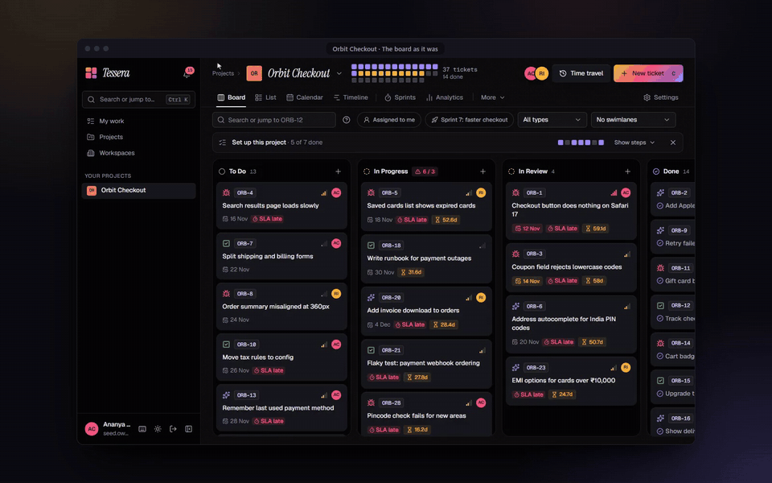
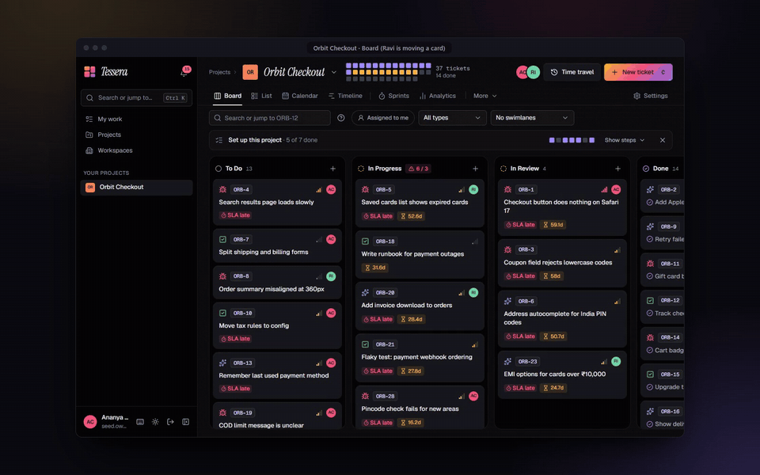
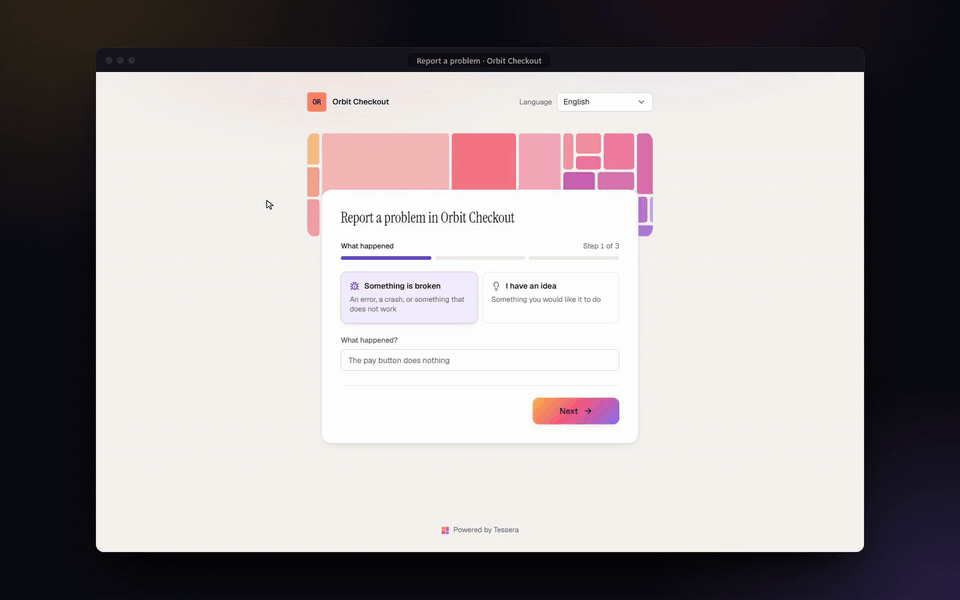
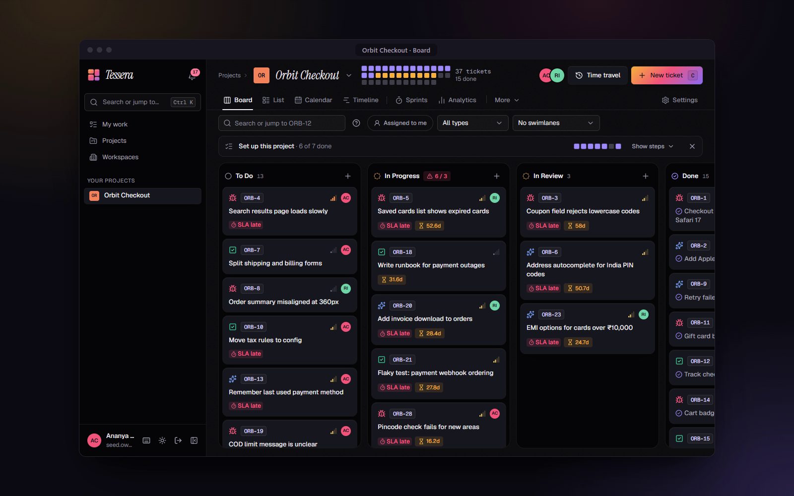
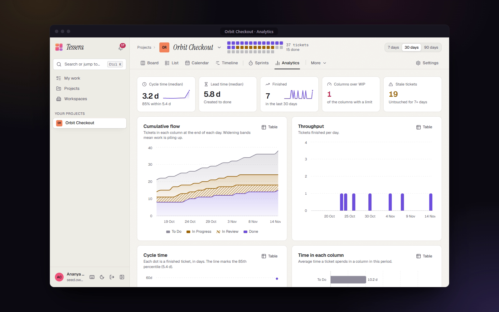

# Tessera

**Issue tracking for teams who ship.** Tessera is a full-stack (MERN) bug and issue tracker in the
spirit of Jira and Linear: projects, tickets, a drag-and-drop Kanban board, comments, filters and
roles. On top of that it adds four things those tools don't give you out of the box: it
**understands stack traces**, it **measures how work flows**, it is **live for everyone at once**,
and it lets **people outside the team** report bugs and close tickets from GitHub.

> Status: feature-complete and tested locally against MongoDB Atlas. Deployment (Render + Vercel)
> is the next step; the live links will be added here once it's up.

## See it

Recorded in the built app (real clicks, real API, real Socket.IO) in a demo project with a made-up
team and nine weeks of made-up history ([`e2e/media/seed.mjs`](e2e/media/seed.mjs)). Each GIF links
to a sharper MP4.

| | |
|---|---|
| [](docs/media/paste-a-stack-trace.mp4) | [](docs/media/time-travel.mp4) |
| **Paste a stack trace, get a bug.** The password, token and email in it are removed before anything is saved. | **Time travel.** The board exactly as it was on any past day, rebuilt from the history. |
| [](docs/media/live.mp4) | [](docs/media/report-a-problem.mp4) |
| **Live.** Ravi picks up ORB-1 on his screen; everyone sees it held, then moved. | **Outside-in.** A client reports a problem without an account and follows it on a private page. |

<p>
  
  
</p>

The app's front page (`/` for visitors, `/tour` for anyone) explains the four signature features
with an interactive demo of each. The demos are labelled as demos, run on sample data in the
browser and use the product's own code: the stack-trace parser and secret redaction from
`server/src/bugs/`, and the Monte Carlo forecast from `server/src/flow/montecarlo.js`.

---

## Contents

- [See it](#see-it)
- [Core features](#core-features)
- [Signature features](#signature-features)
- [Design](#design)
- [Roles and permissions](#roles-and-permissions)
- [Tech stack](#tech-stack)
- [Project structure](#project-structure)
- [Running it locally](#running-it-locally)
- [API overview](#api-overview)
- [Security](#security)
- [Testing](#testing)

---

## Core features

### Accounts
- Register and log in with email and password (bcrypt-hashed). Sessions use JWTs that last 7 days.
- Log out on this device or **log out everywhere**. Logged-out tokens are revoked on the server, not just forgotten by the browser.
- **Account page:** change name, password and email-notification setting, and delete the account.
- **Active sessions:** every device you're signed in on (browser, OS, IP, last active). Sign any one out; its open tabs disconnect at once.
- **Forgot password:** a one-time link by email, valid for 1 hour. The form answers the same for unknown emails, so it can't be used to find out who has an account. Resetting signs out every device.
- **Email verification:** a link is emailed at sign-up. Notification emails only go to confirmed addresses. Accepting an emailed invite or resetting the password also confirms it.
- **Sign in with GitHub or Google:** creates an account from the provider's verified email, or links to the existing account with that email (never an unverified one). 2FA still applies. Connect or disconnect providers on the Account page; the last way to sign in can't be removed. Protected with a signed state plus a browser-bound cookie, PKCE for Google, and a one-time code instead of a token in the URL. Only the provider's account id is stored.
- **Two-factor authentication:** codes from any authenticator app (TOTP, RFC 6238, built on Node's crypto and checked against the RFC's test vectors). The secret is stored encrypted (AES-256-GCM), a code can't be used twice, and ten one-time backup codes cover a lost phone. Turning it off needs the password and a code.

### Projects
- Create, rename, describe, **archive** (read-only) and delete projects. Deleting asks you to type the project key.
- Every project has a short **key** (e.g. `SHOP`), so tickets read `SHOP-12`. Changing the key renames every ticket, and old links still work by number.
- **Invite team members by email.** The link works for 7 days and only for an account with that email address. The invite page also handles signing up, logging in and switching accounts.
- Change members' roles or remove members. A project always keeps at least one admin.
- **Custom board columns:** rename, reorder, add or remove columns. Each column is a To Do, In progress or Done kind. A column can't be removed while it still holds tickets.

### Tickets
- Three types: **bug, feature request and task**. Each ticket has a title, a Markdown description, a priority (low → critical), an assignee, a reporter, labels, a due date and story points.
- Assign tickets only to members of the same project. The assignee picker shows how much open work each person has, and assigning someone who is **heavy or overloaded** asks first and suggests the teammate with the lightest load.
- **Report quality check:** while a bug is written (in the app or on the public page), a checklist shows whether it has steps to reproduce, the expected result and the environment, and can insert headings for whatever is missing.
- **Copy branch name:** one click copies a git branch for the ticket, e.g. `fix/SHOP-12-coupon-field-rejects-valid-codes`.
- Edit everything inline in the ticket drawer. Each ticket has its own URL (`/projects/:id/tickets/SHOP-12`).
- **Delete asks for confirmation** in a popup, then moves the ticket to a bin with an instant *Undo*. Binned tickets can be restored later. Comments and files also ask before they're deleted.
- **Full activity history** for every ticket: who changed what, from what, to what, and when.

### Planning
- **Epics:** a ticket type that groups work. Tickets join an epic from their drawer; the epic shows tickets and story points done, and every card shows its epic.
- **Sub-tasks:** split a ticket into sub-tasks (one level deep); the card shows "2/5" done.
- **Dependencies:** "blocked by" / "blocks" between tickets. Loops are refused. A ticket is blocked while any blocker is still open and frees itself when the last one is done.
- **Flag as blocked:** mark a ticket blocked by hand with a reason ("waiting for the payment provider").
- **Sprints:** a Sprints tab with the running sprint, planned sprints and the backlog. Managers create sprints (dates and a goal), move tickets in with "Move to…" (or from the ticket's Planning section), and start one at a time. Completing a sprint moves unfinished work to a new sprint, a planned one or the backlog. The board has a one-click filter for the running sprint, and a velocity chart compares points committed and finished per sprint.
- **Sprint retro report:** for a running or finished sprint: what was committed at the start, what was added or taken out mid-sprint, what was finished, what slipped and where it went, a burndown (with scope) against an ideal line, and where work waited (time in each column and time blocked, by reason). All of it is rebuilt from the ticket history, so it reflects what actually happened.
- **Milestones:** dated targets ("Public beta, 15 Dec") that any ticket can count towards, with progress in tickets and points, days left, an Overdue badge, close/reopen, and a link to the milestone's tickets.
- **Calendar:** a month view of tickets on their due dates, with sprint starts and ends, milestone due dates and who is on leave each day. Drag a ticket to another day to change its due date, drag an undated ticket in from the side panel, or drop one there to clear its date. Overdue tickets are red.
- **Timeline:** a Gantt-style view of tickets from their start date to their due date, grouped by epic (an epic's bar is its own dates or the span of its tickets), with sprints, milestones, today and team leave on the same axis. 6 weeks, 3 months or 6 months at a time.
- **Swimlanes:** split the board into lanes by assignee, epic or priority. Dragging a card into another lane also reassigns it, moves it to that epic, or changes its priority. Column totals and WIP limits stay across all lanes.
- **Leave calendar:** everyone adds their own leave (dates and an optional note) on the Account page or from the Calendar. Teammates see it on the calendar and timeline, next to the person's name in assignee pickers ("away 17–19 Nov"), and as a warning on a ticket whose assignee is away on its due date.
- **Blocked time:** every blocked spell is recorded with its reason, so each ticket shows how long it has been blocked in total, and Analytics shows blocked hours by reason and the tickets that waited longest.

### Kanban board
- Drag tickets between columns and reorder them inside a column. The change is saved through the API and survives a reload.
- **WIP limits** per column. Going over the limit asks a manager for confirmation, and the override is recorded.
- Quick filters on the board: search or jump to a key, "Assigned to me", ticket type, and the running sprint.
- **Swimlanes** by assignee, epic or priority (see Planning).

### Comments
- **Threaded comments** (reply to a comment) in Markdown.
- **@mentions** notify the person mentioned.
- Edit or delete your own comments. A deleted comment keeps its place so the replies still make sense.
- **Pinned decisions:** pin the comment where something was decided; it is listed in a Decisions box at the top of the ticket, so nobody rereads a long thread to find it.
- **Handoff notes:** reassigning a ticket from one person to another asks for a short note (optional). It is saved on the ticket and sent with the "assigned" notification and email.
- **Internal notes vs replies to the reporter:** comments are team-only by default. On tickets that came from the public bug-report page, a comment can instead be sent as a reply, which is emailed to the reporter and labelled "Sent to reporter"; internal notes never leave the team.

### Search, filters and sorting
- List view with filters for **status, priority, type, assignee, reporter, label, open/closed and due date** (overdue, this week, or a date range).
- **Keyword search** that tries an exact ticket key first, then whole words, then partial matches, and ranks results by relevance.
- Sort by board order, newest, oldest, recently updated, priority, due date or number.
- Filters live in the URL, so a filtered view can be shared as a link.
- **Saved views:** name a set of filters and come back to it later.

### Customisation
- **Custom fields:** up to 20 extra fields per project (text, number, dropdown, date, yes/no, link), set up by managers in Settings. Every ticket shows them in its details, changes are kept in the history, and they come along in CSV export and import. Renaming a field keeps its values; removing a field or a dropdown option clears those values, after a warning.
- **Ticket templates:** ready-made title, description, type, priority, labels, points and sub-tasks. Pick one in New ticket to fill the form; the sub-tasks are created with the ticket.
- **Recurring tickets:** a template made into a ticket on a schedule (every N days, every N weeks on the first day's weekday, or every N months on its day), with an assignee and a due date some days later. "Create now" makes one straight away. Tickets are made while the server is running: if it was asleep (free hosting sleeps when unused) through several runs, it makes one ticket for the latest when it wakes and shows how many were missed, never several copies and never silently. If the person who set it up can no longer create tickets, it pauses itself and says why.

### Search language, triage and setup
- **Search language:** type filters into any search box, mixed with ordinary words: `type:bug assignee:me due:<7d checkout`. Filters are type, priority (also `priority:>=high`), status (column name or key), assignee and reporter (me, none, a name or email), label, is (open, done, unassigned, blocked, overdue, watched), due (`<7d`, `>2w`, a date, overdue, today, week, none), created and updated (`<30d`, `>=2026-11-01`), sprint, epic and sla. Commas mean "either", quotes hold spaces, and a leading - means "not". The list shows in words what it understood ("type is bug", "due before …"), and anything it couldn't use is named and left out, never guessed. Saved views and CSV export use the same language. A ? button next to the search box lists every filter.
- **Keyboard triage:** the Triage tab shows one ticket at a time from a queue (needs an owner, public reports inbox, new this week, or any search). Every decision is a key: 1-4 priority, b/f/t type, m assign to me, a then a number to assign, s then a number for a column, d for a due date, l for labels (a number picks a team label), Enter accepts a public report, Delete bins it with an Undo, j/k move along, ? shows the keys.
- **Project setup templates:** a new project can start from Software Kanban, Scrum, Bug tracking, Support desk or Content calendar. A template sets columns (with WIP limits where they help) and labels only; it never adds example tickets.
- **Team labels:** managers keep a label list in Settings. It is offered in the ticket drawer (one click to add), in triage and in the label filter, even before any ticket uses it.
- **Card layouts:** managers choose what board cards show (key, type, priority, labels, due date, assignee, story points, sub-tasks, epic, SLA, blocked, ageing, error repeats, GitHub links) and up to 3 custom fields.
- **Setup checklist:** managers see a checklist on the board of a new project (columns, labels, invite, first ticket, assign, a routine step, finish a ticket). Each step ticks itself off from what really happened in the project. It can be hidden and brought back from Settings.

### Automation
- **Automation rules:** "when X, do Y", set up by managers in Settings. A rule starts when a ticket is created, moves into a column, changes priority, gets assigned, gets a label, or misses a service-level target. It can be limited to certain types, priorities, labels, or assigned/unassigned tickets. It can assign, set priority, add or remove a label, move to a column, set a due date some days out, or add a watcher. Rules run top to bottom right after the change that starts them; changes a rule makes never start other rules, so rules can't loop. Each change appears in the ticket's history under the rule's name. Settings shows how often each rule ran, and if it couldn't do something (a column at its WIP limit, someone who left), it says what and on which ticket, while the rest of the change still saves.
- **Service levels (SLA):** per priority, hours to the first response and to resolution. They are calendar hours, counted from creation. A first response is a comment from someone other than the reporter, or the ticket leaving a to-do column. The ticket shows both clocks (time left, late by, met, missed), board cards warn when a clock is late or nearly late, the list can filter on it, and Analytics shows how often each target was met. When a ticket goes past a target, it is written to its history and its assignee is notified (managers if nobody is assigned), once. Tickets already late when targets are saved are shown late but not notified. The check runs at start-up and every 5 minutes, so on a sleeping free server a notice can be late but is never lost. Tickets from before service levels get their first-response time from their own history.
- **Audit log:** Settings → Audit log (managers and admins) shows who changed the project's setup and when: members and roles, invites, columns, custom fields, templates, recurring tickets, rules, service levels, sprints, milestones, the public page, GitHub, bulk edits, imports and exports. One middleware on the project routes records every successful change from a single table, so a new endpoint can't quietly skip it. Entries are kept for a year.

### Bulk work, import and export
- **Bulk edit:** tick tickets in the list (or "select all on this page") and change status, priority, type, assignee, sprint or due date, add or remove a label, delete, or restore from the bin, all at once. Each ticket goes through the same rules as a single edit (permissions, WIP limits, history); any ticket that can't be changed is listed with the reason, and the rest still go through.
- **Export CSV:** downloads every ticket matching the list's current filters (up to 5,000), with readable columns (status names, assignee name and email, labels, dates, sprint, milestone, epic). Cells that a spreadsheet would run as a formula are written as plain text.
- **Import CSV:** choose a file and every row is checked first, with nothing saved: problems are shown per row in plain words ("No column called 'Later'"). Then import the valid rows. Title is the only required column; status, assignee (email or name), labels, points, start and due dates (2026-11-30 or 30/11/2026), epic, sprint, milestone and description are read too, and a file exported from Tessera imports as it is. Up to 500 rows and 1 MB; imported tickets don't send a notification each, and their history says they were imported.

### Attachments
- Upload screenshots and files to a ticket. They're stored in MongoDB GridFS, so no extra storage service is needed.
- **Screenshot annotator:** paste or drop an image and mark it up before upload. You can draw boxes and arrows, and **blur** private details. Blurring replaces the pixels, so the hidden part can't be recovered.

### Notifications
- In-app bell for mentions, assignments, comments on your tickets, resolved tickets, regressions and public reports. Mark items read one by one or all at once.
- The same events can also be sent by email (SMTP), and each person can switch email off.

### My work
- One page with every open ticket assigned to you across all projects. Each row shows the column the ticket is in and its due date.
- **Snooze:** hide a ticket until later (this evening, tomorrow, next Monday or any time). It waits in a Snoozed tab and comes back with a reminder notification on time.

### Following tickets
- **Catch me up:** opening a ticket shows what *other people* changed since your last visit (moves, reassignments, edits, files) and marks new comments.
- **Watch:** follow any ticket to hear about every column move and comment, without being its reporter or assignee.

### Everyday UI
- Sidebar dashboard layout, breadcrumbs and project tabs (Board, List, Analytics, Release notes, Settings).
- **Project selector dropdown** on the project name: switch project and stay on the same tab.
- **Command palette (Ctrl/Cmd + K):** search tickets, jump to any project, page or setting, and switch the theme.
- **Light and dark mode**, with your choice remembered.
- Responsive down to phone width. Loaders, empty states and toast messages throughout.
- Pages are code-split, so heavy screens like the charts load only when you open them.

---

## Signature features

These four groups go beyond the original brief and beyond what Jira and Asana offer by default.

### 1. Bug intelligence
- **Secret redaction:** API keys, tokens, JWTs, private keys, passwords in connection strings and email addresses are removed from pasted errors *before* they are parsed or saved, and the paste preview lists what was removed.
- **Paste a stack trace, get a bug.** Tessera parses JavaScript/Node, Python, Java, .NET, Go, PHP, Ruby and Rust stack traces. From the trace it pulls out the error type, the message and the frames, separating your own code from library code.
- **Error fingerprinting:** the same crash, reported again, is grouped into the existing ticket instead of creating a new one. The ticket counts how often the error happened and when it was last seen.
- **Regression detection:** if an error comes back after its ticket was marked Done, the ticket **reopens itself** and the team is notified.
- **Duplicate finder:** while you type a new ticket, Tessera shows similar existing tickets, using TF-IDF text similarity.
- **Error groups** on the analytics page list crashes by impact, with muted ones marked.
- **Every report is kept** (time, browser and OS, who reported it, whether it reopened the ticket or arrived while muted). Outside reporters are counted by a hash of their email, never the address. Counts from before this history existed are shown as "earlier reports", not spread over the chart.
- **Impact score (0–100)**, with a "Why?" breakdown: reports in the last 7 days (up to 40), people affected in the last 30 days (up to 25), times it came back after a fix (up to 15) and priority (up to 20).
- **Regression timeline:** reports per day in the team's time zone, marked with when the ticket was created, finished, came back, linked to a commit or PR, muted and unmuted.
- **Affected environments:** which browsers and operating systems the reports came from, with reports that had no details counted apart. When pasting an error, you say whether it happened in your own browser (ticked by default only for browser JavaScript).
- **Fix memory:** each earlier fix of this crash (who finished it, the commits and PRs linked that round, when it came back), plus finished tickets for *similar* crashes (same error type and a shared frame of your code, or the same message). It also shows in the paste preview before a new ticket is created.
- **Crash spike alerts:** at least 5 reports in an hour, and at least 4 times the usual hourly rate over the week before, alert the owner (or the managers if nobody owns it) in the app and by email. One spike alerts once, and the same error at most once a day. Muted errors never alert.
- **Crash comparison:** two crashes side by side, with the frames both pass through marked, and plain sentences on what is the same and what differs. It describes; it doesn't decide whether they are one bug.
- **Reproduction tracking:** steps to reproduce on any bug, and each teammate's attempt ("reproduced" or "couldn't", where they tried, a note). Search with `is:reproduced` or `is:unreproduced`.
- **Source links:** frames of your code link to that file and line on GitHub. The repository comes from Settings or from the first GitHub webhook delivery. Relative paths link as they are; absolute paths need a "strip this prefix" setting; bundled build files (they need source maps) and Java frames (file name only) are not linked rather than guessed.
- **Muted errors:** mute a known crash for 1 hour, 1 day, 7 days, 30 days or until unmuted, with a reason. New reports are still counted, but they don't reopen the ticket, notify anyone or run automation rules.

### 2. Flow analytics
- **Cumulative flow diagram:** tickets in each column per day. Widening bands mean work is piling up.
- **Throughput** (tickets finished per day) and a **cycle-time scatter** with an 85th-percentile line.
- **Time in each column**, to show where tickets wait the longest.
- **Workload heatmap:** who holds how much work, grouped by due date.
- **Stale tickets:** work nobody has touched for 7 days or more.
- **Ageing cards:** a card in progress longer than the team's own 85th-percentile cycle time (last 90 days) gets an hourglass badge on the board. Needs at least 5 finished tickets, so a new project is never flagged on guesswork.
- Ranges of 7, 30 or 90 days. Every chart has a **table view** for accessibility.
- **Time travel:** see the board *exactly as it was* at any past date and time, rebuilt from the ticket history. Read-only.
- **Release notes generator:** pick a date range (and optionally a version) and get notes grouped into new features and bug fixes from the tickets finished in that range. Preview them or copy them as Markdown.

### 2b. Flow analytics II (the Flow tab)
- **When will it be done?** A Monte Carlo forecast: 10,000 simulated futures, each day drawn from a real day of the last 6 weeks, giving 50/85/95% dates for all open work or the running sprint, and how many tickets will be finished in the next N days. It refuses to forecast with fewer than 5 finished tickets.
- **What if:** add or drop tickets, or change the team's pace, and the dates move.
- **What to work on next:** your tickets and unowned ones ranked by started work, overdue dates, service levels, what they unblock, priority and the sprint, each with its reasons.
- **Why work is slow:** rule-based explanations (over a WIP limit, many blocked, where tickets spend their time, queues, growing columns), each checkable against the numbers.
- **WIP limit suggestions** from Little's law, **estimate accuracy** (did bigger estimates take longer, with rank correlation), **rework rate** (finished then reopened, by cause) and **work mix** per week.
- **Standup** written from the history (finished, moved, in progress, blocked), ready to copy; **compare two dates**; **replay** the board a day at a time in time travel; and the **Project Mosaic**, one tile per ticket.

### 2c. Debug files
- **Log viewer:** "Read" on a .log, .txt or .json attachment shows it with levels (from words like ERROR and WARN, or pino/bunyan JSON lines), stack lines kept with their error, a level filter, search, and "next error" jumps. Times with a zone become exact moments; times without one are shown as written, never guessed. If a log seems to contain secrets, the viewer says so (logs are stored as uploaded).
- **HAR files are cleaned before they are stored:** cookies, auth and session headers, token and password parameters in URLs, form and JSON bodies, email addresses and known token formats are removed, and response bodies are dropped (their size is kept). Only the cleaned file ever reaches the database, and the ticket shows what was removed. "Requests" then lists failed, slowest and largest requests and time and size per server.
- **CI test results:** upload a JUnit XML report on the Deploys page, or send it from CI with an upload token (`POST /api/test-results`). Tessera keeps the last 200 runs and finds **flaky tests** (passed and failed on the same commit, or flipped between pass and fail at least twice) and **failing tests** (failed in the last runs in a row), with the last failure message, and makes a ticket for one in a click.
- **Screen recording:** "Record" on a ticket's files records one screen, window or tab, up to 60 seconds and under 9 MB, without sound. Nothing is uploaded until the person has watched it and chosen to attach it.

### 2d. Notifications and integrations
- **Quiet hours and digests:** in Account, pick your time zone and either quiet hours (emails are held, the bell still shows everything, and one summary arrives when quiet hours end, listing what you still haven't read) or a daily / weekly digest at your hour instead of single emails. Account emails such as "confirm your email" are never held.
- **Slack and Discord alerts:** paste a channel's incoming-webhook URL in project Settings, pick the events (new, moved, finished, assigned, commented, edited) and optionally only some priorities. The URL is stored encrypted and never shown again. Discord messages can never ping @everyone. "Test" sends one now and says what the other side answered.
- **Outgoing webhooks:** signed JSON POSTs to your own endpoint (`X-Tessera-Signature: sha256=` HMAC with a secret shown once, `X-Tessera-Event`, `X-Tessera-Delivery`). Server errors and rate limits are retried twice; after 20 failures in a row a target pauses. In production, addresses on private or local networks are refused. The last deliveries and their answers are listed.
- **Personal API tokens** (`tsp_`): read-only or read and write, with an expiry; only a hash is stored. Tokens act as you in your projects but can never change your password, 2FA, sessions or tokens, or delete the account.
- **CLI** (`cli/`, no dependencies): `node cli/bin/tessera.mjs login <api-url> <token>`, then `projects`, `list KEY --mine --open`, `show KEY-12`, `create KEY "title" --type bug`, `move KEY-12 "In Progress"`, `assign KEY-12 me`, `comment KEY-12 "text"`, with `--json` for raw output. Settings are saved in `~/.tessera.json` (owner-only), or come from `TESSERA_URL` / `TESSERA_TOKEN`.
- **GitLab:** connect in Settings and add the webhook (push and merge request events) with its secret token. Commits and merge requests that mention a ticket link to it; "Closes KEY-12" on the default branch or in a merged merge request finishes it (and counts for DORA lead time). With an optional read_api token, merge requests show their pipeline status.

### 2e. Platform
- **Workspaces:** a team or company groups its projects and people (owners, admins, members). Project roles still decide what someone can do; a project admin can put the project in a workspace and add the whole team in one step. Deleting a workspace never deletes its projects.
- **Backup and import:** admins download the whole project as one JSON file (settings, people by email, sprints, milestones, tickets, comments). It imports as a new project, matching people to existing accounts by email. Secrets, links, outside reporters' details and file contents are never in a backup.
- **Storage:** each project's file usage against its allowance, with a warning on the board at 80% and 95% for managers, the largest files, and a list of files on tickets finished or deleted long ago to clear in one go (recorded on each ticket).
- **Installable app:** a web app manifest with real icons and a service worker, so Tessera installs like an app and opens offline to its last loaded screen (only the app's own files are cached, never data or API answers).
- **Push notifications:** turn them on per device in Account. They use the server's own VAPID keys (generated locally), go only to real browser push services, and are not sent while you have Tessera open or during your quiet hours. Gone devices are forgotten automatically.
- **Offline comment drafts:** a half-written comment is kept per ticket in your browser until it is sent. A comment written while offline waits and is sent when the connection comes back.

### 2f. Engineering quality
- **API documentation:** `/api/docs` (Swagger UI) and `/api/openapi.json` (OpenAPI 3.1). The document is built from the running routes: every endpoint, the request schemas the server actually validates (zod → JSON Schema), the project role each one needs, and which are public. It cannot drift from the code.
- **Browser tests** (`e2e/`, Playwright): sign up and work a ticket through the UI; a comment written offline waiting and sending itself when the connection returns, and a draft surviving a reload; a public report followed on its tracking page, answered, and read in Spanish. They run the built app against a throwaway in-memory database: `cd e2e && npm install && npx playwright test` (uses the installed Chrome locally).
- **Load test:** `cd server && npm run loadtest -- --clients 500 --updates 30` starts the API on an in-memory database, connects that many Socket.IO clients to one board and times how long each ticket change takes to reach every one of them. Measured on a Windows laptop (Node 25, server and clients in one process): 100 watchers, 3,000 of 3,000 updates delivered, p95 10 ms; 500 watchers, 15,000 of 15,000 delivered, p50 17 ms, p95 21 ms, p99 23 ms.
- **CI** (`.github/workflows/ci.yml`, GitHub Actions, free on a public repository): server tests, a dependency audit, a 200-watcher load test, the client build, and the browser tests in Chromium, on every push to main and every pull request. No secrets needed.

### 3. Live collaboration (Socket.IO)
- Cards move on everyone's board **as they move**, with no refresh.
- **Presence:** avatars of who is looking at the project and at each ticket.
- **Typing indicators** in comments.
- Notifications arrive live in the bell.
- **Estimate together** (the Together tab, or "Estimate together" on a ticket): planning poker where everyone sees who has voted but not what until the votes are shown, then the range, the middle value and whether everyone agreed; choosing a value sets the ticket's story points and is recorded in its history.
- **Retro boards:** Went well / To improve / Actions, a limited number of votes per person (a vote can be taken back), notes sorted by votes, a ticket made from an action note in one click, closed by a manager.
- **Incident mode:** starting an incident opens a critical ticket labelled `incident`, shows a banner on everyone's board, keeps a timeline (notes, commander and severity changes), and closes the ticket when resolved. The **postmortem** is written from the record: the timeline, deploys and crash reports during the incident, follow-up tickets, and the root cause and lessons the team wrote (or "Not written yet").
- **Edit conflict protection:** if someone else changed the title or description you were editing, saving does not overwrite it; you see their version next to yours and choose. Other fields still merge.

### 4. Outside-in workflow
- **Crash capture from your own apps:** make an ingest key in Settings (shown once, stored only as a hash, optionally limited to your websites, revocable) and add one script tag to your site. Uncaught errors and rejected promises arrive as bugs in the triage inbox, with the browser, the page (without its query string), and the release and environment you set; repeats are counted on the same ticket and feed impact, spikes and regressions. `Tessera.capture(error)` sends your own; servers can POST JSON to `/api/ingest`. The SDK (`/sdk/tessera.js`) has no dependencies, never sends the same error twice within 10 seconds, and stops after 25 reports per page.
- **Report button for your website:** turn it on in Settings (public page section), list your websites, and paste one script tag. Visitors get a "Report a problem" button (in its own shadow DOM, so it never clashes with the site) that sends the page address without its query string, the browser and window size, an optional screenshot of the page or an attached image marked up with boxes, and the page's recent console errors only if they tick the box after seeing them. Reports land in the triage inbox like portal reports.
- **Private tracking link for every reporter:** each report from the public page or the report button gets its own link (in the receipt email and on the "thanks" screen). It shows where the report is (received, accepted, being worked on, fixed, and the release it shipped in), and a conversation with the team: the reporter can add details there, and the team's "Reply to reporter" comments appear there too (and are emailed when they left an address). Internal comments never show. Reporters without an email still get answers this way.
- **"Fixed / Still broken":** the fixed email has two links to the tracking page, where one click confirms (nothing is recorded just by opening the email, so link scanners can't answer for them). "Still broken" reopens the ticket and tells its assignee; the team sees every reporter's answer on the ticket.
- **Merging duplicate reports:** "Merge into…" on a ticket closes it as a duplicate of another. Its reporters move over, keep their links, get a short email saying the reports were joined, and are told when the surviving ticket is fixed. Closing the duplicate emails nobody.
- **Public roadmap:** managers publish a roadmap page and tick "On the public roadmap" on the tickets to show. Visitors see Planned / In progress / Done (done for 90 days) and vote, one vote per item per browser (a random id kept in their browser; the server stores only a hash). The team sees the vote counts in Settings.
- **Read-only board links:** share the board with clients or stakeholders without an account. They see columns, titles, labels, points and due dates (assignee names only if ticked), never comments, attachments, reporters or the triage inbox. Each link shows when it was last opened and can be turned off at once.
- **Multilingual public pages:** the report, tracking and roadmap pages speak English, Spanish, French, German, Hindi and Bengali (following the browser, or picked on the page). Only the pages' own text is translated; what people write, and error messages from the server, stay in the language they were written in.
- **Source maps:** upload a release's `.map` files in Settings, or from CI with an upload token (`tsu_`, a secret that can only upload maps, never send crashes; crash keys can't upload maps). Crashes from that release's minified scripts then show the original files, lines, function names and the code around each line, keep the built position on hover, group across builds by their original frames, and get source links. Maps are matched by release, or by a hashed built file name; nothing is guessed. Tickets from before an upload can be unminified afterwards; if that makes them the same crash as another ticket, the two are left apart and named, never merged silently.
- **Public bug-report page:** a shareable link where clients can report a bug or suggest an idea **without an account**. Reports land in a **triage inbox**, where the team accepts or rejects them. A reporter who leaves an email is told by email that the report was received, and again when it's fixed. That includes people whose report was added to a known crash (up to 25 per ticket).
- The link can be **rotated** if it leaks. Spam protection comes from a hidden honeypot field, rate limiting, and optional Cloudflare Turnstile.
- **Deployments:** deploys arrive from GitHub (deployment status events), from a deploy token your pipeline calls, or by hand. A ticket finished by a merge shows "merged, not deployed yet" until the next successful production deploy, then "live since … (release …)". A crash that comes back names the release it came back in. Reporter "fixed" emails can wait for the deploy. The Deploys tab shows DORA numbers (deploy frequency, lead time, change failure rate, time to restore) with their definitions, and the deploy history. An opt-in public status page and README badge (status, release or deploys a week) show only the last deploy, deploy history and open tickets labelled `incident`.
- **GitHub, deeper (with a token for the repository):** pull request status on cards and tickets (draft, review verdicts, CI, conflicts, and a warning when code changed but no test did), refreshed by the webhook; cards move to a chosen column when a branch or a ready pull request for them appears (forward only); for a crash, the suspect commit (the last change to the crashing file before it was first seen) and who knows that file best, with one-click assign; code health in Analytics: bug hotspots, knowledge risk (areas one person wrote 75%+ of, from up to 100 recent commits) and a TODO/FIXME scanner that turns comments into tickets; two-way GitHub Issues sync (new issues become tickets; title, description and open/closed follow each other; GitHub comments come in; Tessera's own comments are not published). The token is stored encrypted and never shown again.
- **GitHub integration:** connect a repository with a signed webhook (HMAC SHA-256). Commits and pull requests that say *"fixes SHOP-12"* close that ticket when merged or pushed to the main branch. The linked commits and PRs show on the ticket.

---

## Design

Tessera's name is the small tile a mosaic is made of: every ticket is a tile, and a board is a
window of them. The mark is four panes of glass lit by one gradient (amber, rose, violet), and
the same stained glass appears in empty states, the sign-in page and the public pages. The other
directions explored on the way are in [`design/directions/`](design/directions/).

**Principles.** Content before chrome; one primary action per view; the same control for the same
job everywhere; quiet until something needs attention. The redesign was checked against Linear
and Vercel in a [design review](docs/design-review.md): ten issues with before and after
screenshots (a board header 290 px tall, a gradient "Save" on every settings form, cards inside
cards in the ticket drawer, and so on), each fixed.

**Tokens, not one-off values.** Colours, type, radii, elevation and motion live in
[`client/src/ds/tokens.css`](client/src/ds/tokens.css) and [`client/src/index.css`](client/src/index.css),
and components use only those:

- *Colour:* surfaces (canvas, sunken, surface, raised, overlay), a four-step text ramp, a key
  colour, status, priority and chart palettes. Dark mode is designed first; light mode has its own
  chosen values, not an inversion.
- *Type:* Geist for the interface, Instrument Serif (italic) for titles, Geist Mono for keys and
  code; nine sizes from 48 px display down to 11 px micro.
- *Shape and depth:* five radii (2, 4, 6, 10, 16 px) and four elevations.
- *Motion:* a few durations and easings, used for meaning (a card landing, a change arriving
  from someone else), and still when the system asks for reduced motion.

**Personal, within limits.** Each person picks light, dark or system, comfortable or compact
density, and one of eight accent colours, each checked to keep text at 4.5:1 contrast or better in
both themes. The choice is saved with the account and painted before the first frame.

**Words.** [`docs/voice.md`](docs/voice.md): clear, warm, a little witty in empty states and never
cute in errors, which always say what happened and what to do next.

**Charts.** One axis per chart, colour that follows the thing and never its rank, a texture as well
as a colour for each series, and a table view for every chart.

**Accessible and fast, and measured.** WCAG AA throughout, with a visible focus ring on every Tab
stop and a board that can be worked entirely from the keyboard (a card is picked up with Space,
moved with the arrows, and the board says where it is). axe finds no violations on 24 states in
light or dark. Lighthouse on mobile settings (median of three cold runs, the same in both themes):
the front page 97, sign-in 100, the public report page 96, the board 86 and analytics 90, with
accessibility, best practices and SEO at 100 on every page and layout shift of 0.006 at most. Heavy parts (charts, the drawer, the demos) load only when needed. The
audit tools are in [`e2e/audit/`](e2e/audit/README.md).

**Screens and recordings.** Every image above comes from [`e2e/media/record.mjs`](e2e/media/record.mjs):
real interactions in the built app, in one frame (a window with a title bar and a soft shadow on
the brand background), as MP4 and GIF.

---

## Roles and permissions

| Role | Can |
|---|---|
| **Admin** | Everything, including deleting or archiving the project and managing other admins |
| **Manager** | Manage members (developers and viewers), invites, columns, the public page and integrations; plan, start and complete sprints; manage milestones; edit or delete any ticket |
| **Developer** | Create and edit tickets, move cards, comment and upload; delete tickets they reported |
| **Viewer** | Read everything and comment |

Permissions are checked on the server for every request. The UI only hides what you can't do.

---

## Tech stack

| Layer | Choice | Why |
|---|---|---|
| Frontend | **React 19**, **Vite** | Fast, component-based UI |
| Styling | **Tailwind CSS v4** (JS-only Vite plugin, `client/tailwind-js.mjs`) | Responsive styling with a dark mode variant; the plugin avoids Tailwind's native scanner, which Windows Smart App Control blocks |
| Drag and drop | **dnd-kit** | Accessible and maintained (react-beautiful-dnd is deprecated) |
| Routing | **React Router** | Nested routes, public and protected pages |
| Server state | **TanStack Query** + `fetch` | Caching, live invalidation from sockets |
| Global state | **React Context** | Signed-in user and auth actions |
| Charts | **Recharts** | Analytics |
| Markdown | **marked** + **DOMPurify** | Safe Markdown in descriptions and comments |
| Backend | **Node.js 22**, **Express 5** | REST API |
| Database | **MongoDB Atlas** + **Mongoose** | Documents fit tickets, history and comments; GridFS for files |
| Auth | **JWT** + **bcrypt** | Stateless auth with server-side revocation |
| Validation | **zod** | Every request body and query is validated |
| Real time | **Socket.IO** | Live board, presence, typing, notifications |
| Uploads | **Multer** → GridFS | Attachments |
| Email | **Nodemailer** (SMTP) | Invites and notifications |
| Security | **Helmet**, **CORS**, **express-rate-limit** | Headers, origins, abuse limits |
| Config | `.env` loaded with Node's built-in `process.loadEnvFile` | Same job as dotenv, without the extra package |

---

## Project structure

```
tessera/
├── postman/                Postman collection (43 requests with assertions) + its generator
├── docs/                   design review, voice and tone, the README's images and clips
├── e2e/                    Playwright browser tests, visual checks, audits (Lighthouse, axe),
│                           and media/ (the demo seed and the recorder behind the README's images)
├── client/                 React app (Vite)
│   └── src/
│       ├── pages/          Landing (public front page), Auth, Projects, Board, List, Calendar, Timeline,
│       │                   Sprints (+ milestones), Sprint report, My work, Analytics, Settings,
│       │                   Release notes, Portal (public), Invite
│       ├── landing/        the front page's four demos (they import the server's pure modules)
│       ├── ds/             design system: tokens, surfaces, core components, motion
│       ├── components/     AppShell, TicketDrawer, NewTicketDialog, Annotator,
│       │                   CommandPalette, NotificationsBell, TimeTravelBoard, ui
│       ├── context/        AuthContext
│       └── lib/            api (fetch wrapper), socket, queries, format, theme, i18n
└── server/                 Express API
    ├── src/
    │   ├── models/         User, Project, Ticket, TicketEvent, Comment, Attachment,
    │   │                   ProjectInvite, SavedFilter, Notification, RevokedToken
    │   ├── routes/         auth, projects, tickets, invites, me, notifications,
    │   │                   portal, GitHub hooks
    │   ├── controllers/    thin request/response layer
    │   ├── services/       business logic (tickets, search, flow, bugs, portal,
    │   │                   github, release notes, notifications, ...)
    │   ├── bugs/           stack-trace parser, secret redaction and similarity search
    │   ├── flow/           the Monte Carlo forecast (pure; the landing page runs it too)
    │   ├── schemas/        zod validation
    │   └── realtime.js     Socket.IO
    └── test/               node:test + in-memory MongoDB
```

**Data model in one line:** a Project has many Tickets (many-to-one). A Ticket has many Comments,
Attachments and TicketEvents (one-to-many). Every change is written to `TicketEvent` as an
append-only history. That history is what powers the activity feed, the analytics and time travel.

---

## Running it locally

Requires **Node.js 22+** and a MongoDB Atlas cluster (the free tier works).

```bash
# 1. API
cd server
npm install
cp .env.example .env      # then fill in MONGODB_URI, JWT_SECRET, SMTP_* ...
npm run dev               # http://localhost:8740

# 2. Web app (second terminal)
cd client
npm install
npm run dev               # http://localhost:5210
```

Locally the Vite dev server proxies `/api` and `/socket.io` to the API. In production the client
uses `VITE_API_URL`.

### Environment variables (server)

| Variable | Purpose |
|---|---|
| `MONGODB_URI` | Atlas connection string (database `tessera`) |
| `JWT_SECRET` | Long random string for signing tokens |
| `PORT` | API port (default 8740) |
| `CLIENT_ORIGIN` | Allowed browser origins, comma-separated |
| `APP_URL` | Web app address, used for links in emails |
| `API_URL` | Public API address, used for the GitHub webhook URL |
| `SMTP_HOST`, `SMTP_PORT`, `SMTP_USER`, `SMTP_PASS` | Email for invites and notifications |
| `TRUST_PROXY` | `1` behind one proxy (Render) |
| `TURNSTILE_SITE_KEY`, `TURNSTILE_SECRET` | Optional captcha on the public report page |
| `APP_TIMEZONE` | Time zone for "today", due dates and analytics (default `Asia/Kolkata`) |
| `DNS_SERVERS` | Optional, for networks that can't resolve `mongodb+srv` |

---

## API overview

All routes are under `/api`, return JSON, and (except the public ones) need `Authorization: Bearer <token>`.

| Area | Endpoints |
|---|---|
| Auth | `POST /auth/register`, `POST /auth/login`, `POST /auth/login/2fa`, `GET/PATCH/DELETE /auth/me`, `POST /auth/logout`, `POST /auth/logout-all`, `POST /auth/password` |
| Account security | `POST /auth/forgot`, `POST /auth/reset`, `POST /auth/verify`, `POST /auth/verify/resend`, `GET /auth/sessions`, `DELETE /auth/sessions/:id`, `GET /auth/2fa`, `POST /auth/2fa/setup`, `POST /auth/2fa/confirm`, `POST /auth/2fa/disable`, `POST /auth/2fa/backup-codes` |
| GitHub / Google sign-in | `GET /auth/oauth/providers`, `GET /auth/oauth/:provider/start`, `GET /auth/oauth/:provider/callback`, `POST /auth/oauth/:provider/link-intent`, `POST /auth/oauth/exchange`, `DELETE /auth/oauth/:provider` |
| Projects | `GET/POST /projects`, `GET/PATCH/DELETE /projects/:id`, `POST /projects/:id/archive`, `POST /projects/:id/unarchive`, `PUT /projects/:id/statuses`, `GET /projects/:id/labels` |
| Members & invites | `GET /projects/:id/members`, `PATCH/DELETE /projects/:id/members/:userId`, `GET/POST /projects/:id/invites`, `DELETE /projects/:id/invites/:inviteId`, `GET /invites/:token`, `POST /invites/:token/accept`, `POST /invites/:token/decline` |
| Tickets | `GET/POST /projects/:id/tickets`, `GET/PATCH/DELETE /projects/:id/tickets/:ref`, `POST .../:ref/move`, `POST .../:ref/restore`, `POST .../:ref/accept`, `GET .../:ref/history` |
| Customisation | `PUT /projects/:id/fields` (managers), tickets take `fields: { key: value }`; `GET/POST /projects/:id/templates`, `PATCH/DELETE .../templates/:templateId`, `POST .../tickets` with `templateId`; `GET/POST /projects/:id/recurring`, `PATCH/DELETE .../recurring/:recurringId`, `POST .../recurring/:recurringId/run` |
| Setup and search | `GET /projects/setup-templates`, `POST /projects` takes `template`; `PUT /projects/:id/labels` (`{ labels }`), `PUT .../card-layout` (`{ fields }`), `GET .../setup` (the checklist), `POST/DELETE .../setup/dismiss`; the list's `q` understands the search language and returns `search.understood` and `search.problems` |
| Automation | `GET/POST /projects/:id/rules`, `PATCH/DELETE .../rules/:ruleId`, `PUT .../rules/order` (`{ ids }`, top to bottom); `PUT /projects/:id/sla` (`{ enabled, targets: [{ priority, responseHours, resolveHours }] }`), `GET .../sla/report?days=30`; tickets carry `sla` and the list takes `sla=breached` or `sla=at_risk`; `GET /projects/:id/audit?area=&before=` (managers) |
| Bulk, export, import | `POST /projects/:id/tickets/bulk` (`{ tickets, action: update / delete / restore, changes }`), `GET .../tickets/export` (same filters as the list, returns CSV), `POST .../tickets/import` (multipart `file`; `?dryRun=true` to check only, `?skipInvalid=true` to import the valid rows) |
| Comments | `GET/POST /projects/:id/tickets/:ref/comments`, `PATCH/DELETE .../comments/:commentId` |
| Attachments | `GET/POST /projects/:id/tickets/:ref/attachments`, `GET/DELETE .../attachments/:attachmentId` |
| Flow II | `GET /projects/:id/flow/forecast?scope&add&factor&days`, `GET /projects/:id/flow/next`, `GET /projects/:id/flow/insights`, `GET /projects/:id/flow/standup`, `GET /projects/:id/flow/compare?from&to`, `GET /projects/:id/flow/mosaic` |
| Together | `GET` / `POST /projects/:id/poker`, `PUT .../poker/:roundId/vote`, `POST .../poker/:roundId/{reveal,revote,accept}`; `GET` / `POST /projects/:id/retros`, `GET .../retros/:retroId`, `POST .../retros/:retroId/items`, `POST` / `DELETE .../items/:itemId`, `POST .../items/:itemId/{vote,ticket}`, `POST .../retros/:retroId/close`; `GET` / `POST /projects/:id/incidents`, `GET` / `PATCH .../incidents/:incidentId`, `POST .../resolve`, `GET .../postmortem`; `PATCH` a ticket with `expectedUpdatedAt` for conflict protection (409 `edit_conflict`) |
| Deployments | `POST /api/deploys` (deploy token), `GET` / `POST /projects/:id/deploys`, `PUT /projects/:id/deploys/settings`, `GET /api/status/:token`, `GET /api/status/:token/badge.svg?show=status|release|deploys` |
| GitHub (token) | `GET /projects/:id/github`, `PUT` / `DELETE /projects/:id/github/token`, `PUT /projects/:id/github/options`, `POST /projects/:id/github/issues/import`, `GET /projects/:id/github/insights`, `POST /projects/:id/github/knowledge`, `POST /projects/:id/github/todos`, `POST /projects/:id/github/todos/ticket`, `POST /projects/:id/tickets/:ref/github/refresh` | `suspect` | `issue` |
| Platform | `GET` / `POST /api/workspaces`, `GET` / `PATCH` / `DELETE /api/workspaces/:id`, `POST .../members`, `PATCH` / `DELETE .../members/:userId`; `PUT /projects/:id/workspace`, `POST /projects/:id/members/from-workspace`; `GET /projects/:id/export`, `POST /api/projects/import` (multipart `file`, `key`, `name`); `GET /projects/:id/storage?days`, `GET .../storage/summary`, `POST .../storage/cleanup`; `GET` / `POST` / `DELETE /api/me/push`, `POST /api/me/push/test` |
| Notifications and integrations | `GET` / `PUT /api/me/notifications`; `GET` / `POST /api/me/tokens`, `DELETE /api/me/tokens/:tokenId` (login only); `GET /projects/:id/integrations/outbound`; `POST /projects/:id/integrations/alerts` and `/webhooks`, `PATCH` / `DELETE .../alerts/:alertId` and `.../webhooks/:webhookId`, `POST .../test`; `GET` / `PUT` / `DELETE /projects/:id/integrations/gitlab`, `PUT` / `DELETE .../gitlab/token`; `POST /api/hooks/gitlab/:projectId` (X-Gitlab-Token). Any authenticated route also accepts `Authorization: Bearer tsp_...` |
| Debug files | `GET /projects/:id/tickets/:ref/attachments/:attachmentId/log?level&q&offset`, `GET .../attachments/:attachmentId/har`; `GET /projects/:id/tests?runs=30`, `POST /projects/:id/tests` (multipart `file`, `branch`, `commit`, `name`), `DELETE .../tests/:runId`, `POST .../tests/ticket` (`{ key }`); `POST /api/test-results` (upload token, same fields) |
| Client-facing | `GET /api/track/:token`, `POST /api/track/:token/messages`, `POST /api/track/:token/answer` (`fixed` / `broken`); `GET /api/roadmap/:token`, `POST /api/roadmap/:token/items/:number/vote` (header `x-roadmap-voter`); `GET /api/shared/:token`; `GET /projects/:id/tickets/:ref/reporters`, `POST .../merge` (`{ into }`), `PUT .../roadmap` (`{ onRoadmap }`); `GET` / `PUT /projects/:id/roadmap`; `GET` / `POST /projects/:id/share-links`, `DELETE .../share-links/:linkId`; comments to reporters take `trackerId` |
| Crash capture | `POST /api/ingest` (public, key in the body), `GET /sdk/tessera.js`, `POST /api/sourcemaps` (upload token), `POST /api/widget/:portalToken`, `GET /sdk/widget.js`, `GET` / `POST` / `DELETE /projects/:id/sourcemaps`, `POST /projects/:id/tickets/:ref/error/unminify`, `GET` / `POST /projects/:id/ingest-keys`, `DELETE /projects/:id/ingest-keys/:keyId` |
| Bug intelligence | `POST /projects/:id/tickets/parse-error`, `POST /projects/:id/tickets/similar`, `GET /projects/:id/errors`, `GET /projects/:id/tickets/:ref/error/insights`, `PUT` / `DELETE /projects/:id/tickets/:ref/error/mute`, `GET /projects/:id/errors/compare?a=&b=`, `GET` / `PUT /projects/:id/tickets/:ref/repro/steps`, `POST` / `DELETE /projects/:id/tickets/:ref/repro/attempts`, `PUT /projects/:id/source` |
| Analytics | `GET /projects/:id/analytics`, `GET /projects/:id/board-at`, `GET /projects/:id/workload`, `GET /projects/:id/release-notes` |
| Public page | `GET/PUT /projects/:id/portal`, `POST /projects/:id/portal/rotate`, `GET /portal/:token`, `POST /portal/:token/reports` |
| GitHub | `GET/PUT/DELETE /projects/:id/integrations/github`, `POST /hooks/github/:projectId` |
| Planning | `GET /projects/:id/tickets/:ref/relations`, `PUT .../:ref/epic`, `PUT .../:ref/parent`, `POST .../:ref/subtasks`, `POST .../:ref/blockers`, `DELETE .../:ref/blockers/:blocker`, `PUT/DELETE .../:ref/flag` |
| Sprints and milestones | `GET/POST /projects/:id/sprints`, `PATCH/DELETE .../sprints/:sprintId`, `POST .../sprints/:sprintId/start`, `POST .../sprints/:sprintId/complete`, `GET .../sprints/:sprintId/report`, `GET/POST /projects/:id/milestones`, `PATCH/DELETE .../milestones/:milestoneId`, `PUT .../tickets/:ref/sprint`, `PUT .../tickets/:ref/milestone`. The ticket list also takes `sprint=<id>`, `sprint=active`, `sprint=none` and `milestone=<id>`, `milestone=none` |
| Schedule and leave | Tickets take an optional `startDate` (on or before `dueDate`); the ticket list takes `scheduled=true` or `scheduled=false`. `GET/POST /me/leave`, `DELETE /me/leave/:leaveId`, `GET /projects/:id/leave?from=&to=` |
| Following | `POST /projects/:id/tickets/:ref/visit`, `PUT/DELETE .../:ref/watch`, `PUT/DELETE .../:ref/snooze`, `GET /projects/:id/ageing` |
| Me | `GET /me/tickets` (`?snoozed=true`), `GET/POST /me/filters`, `PATCH/DELETE /me/filters/:filterId`, `GET /notifications`, `POST /notifications/read` |

`:ref` is a ticket key like `SHOP-12` or just its number.

---

## Security

- Passwords hashed with bcrypt. JWTs carry a token id and a version, so logging out or changing your password revokes them on the server.
- Every input validated with zod. Request bodies are size-limited.
- Helmet security headers and a CORS allow-list.
- Rate limits on login, registration and the public report page.
- Invite links and the public page link are random tokens. Only a SHA-256 hash of an invite token is stored.
- GitHub webhooks are verified with an HMAC SHA-256 signature.
- Markdown is sanitised with DOMPurify before display.
- Role checks happen on the server for every request.

---

## Testing

```bash
cd server
npm test
```

There are **269 automated tests** (`node:test` with an in-memory MongoDB). They cover auth and token
revocation, projects and roles, invites, tickets and drag-and-drop ordering, search and filters,
comments, attachments, the stack-trace parser and error grouping, impact scores, regression timelines, fix memory, muted errors, Go/PHP/Ruby/Rust traces, spike alerts, crash comparison, reproduction tracking, source links, ingest keys and the crash capture SDK, source maps, the report button, GitHub pull request status, card moves, suspect commits, code health and issue sync (against GitHub's response formats), deploys, DORA and the status page, the Monte Carlo forecast, next best ticket, flow insights, standup, date comparison and the mosaic, planning poker, retro boards, incidents and postmortems, edit conflicts, tracking links and reporter conversations, fixed / still broken, merging duplicates, the public roadmap and voting, read-only board links, the log parser, HAR cleaning and analysis, the JUnit reader and flaky-test detection, API tokens and the CLI, Slack / Discord alerts, signed webhooks, quiet hours and digests, the GitLab webhook, workspaces, backup and import, storage clean-up, push notifications, flow analytics and time travel, planning (epics, dependencies, sprints, the retro report, milestones, start dates, leave), bulk edit, CSV export and import, custom fields, templates and recurring tickets, automation rules, service levels and the audit log, the search language, setup templates, card layouts and the setup checklist,
notifications, real-time events, the public report page, GitHub webhooks and rate limiting.
Every screen has also been checked by hand in the browser against a real Atlas database, at desktop
and phone sizes, in light and dark mode.

### Postman

[`postman/Tessera.postman_collection.json`](postman/Tessera.postman_collection.json) has **43 requests,
each with assertions**, in folders that follow the use cases: health, authentication, projects,
tickets, Kanban moves, threaded comments, filter/search/sort, bug intelligence and analytics, delete
and restore, and clean-up. Error cases are covered too: a wrong password, a missing token, a weak
password, a bad project key, a ticket with no title, assigning someone outside the project, an
unknown column, and deleting a project with the wrong key.

The run registers a throwaway account and then deletes its project and the account at the end, so
it leaves nothing behind.

- **In Postman:** Import the file, set the `baseUrl` collection variable (default
  `http://localhost:8740/api`), then run the collection with the **Collection Runner**.
- **From the terminal:**

  ```bash
  npx newman run postman/Tessera.postman_collection.json
  # against the deployed API:
  npx newman run postman/Tessera.postman_collection.json --env-var baseUrl=https://<your-api>/api
  ```

The collection is generated from `postman/build-collection.mjs`. Edit that file, then run
`node postman/build-collection.mjs` to rebuild the JSON.

---

Built by **Sagnik Bhowmik**.
