# Tessera

**Issue tracking for teams who ship.** Tessera is a bug and issue tracker in the spirit of Jira and Linear, with four
things those tools don't give you out of the box: it **reads stack traces**, it **forecasts from your own history**, it
is **live for everyone at once**, and it lets **people outside the team** report problems and follow them.

**Live:** https://tessera-eight-gamma.vercel.app · **API:** https://tessera-api-7hwj.onrender.com/api/health ·
**API docs:** [/api/docs](https://tessera-api-7hwj.onrender.com/api/docs) · **Every feature:** [docs/FEATURES.md](docs/FEATURES.md) ·
**Run it yourself:** [docs/FEATURES.md#running-it-locally](docs/FEATURES.md#running-it-locally) · **Deployment notes:** [DEPLOY.md](DEPLOY.md)

---

## 1. Introduction

A tracker is only as useful as what goes into it, and the most important input, a crash, usually arrives as a wall of
stack trace pasted into a ticket by hand. Tessera starts there. Paste an error and it reads the trace (eight languages),
takes the passwords and tokens out before anything is saved, and files it as a bug; the same crash reported again is
counted on the same ticket, and a crash that comes back after its fix reopens its ticket by itself.

It started from a student brief: a project management app with React, Express and MongoDB, projects, tickets, a Kanban
board with drag and drop, comments, filters and roles. It then grew into a complete product with about 30 screens, built
step by step with every step tested: sprints and a timeline, flow analytics and forecasts, live collaboration over
Socket.IO, a public bug-report page for clients, GitHub and GitLab integration, a crash-capture script for your own
websites, two-step sign-in and an installable app. Nothing in it is simulated; every number comes from the team's real
history.

**Highlights**

- Paste a stack trace, get a bug: secrets removed first, repeats grouped by fingerprint, regressions reopen themselves.
- A board that is live for everyone: cards move as they move, with who is looking and who is typing.
- Dates from your own history: a Monte Carlo forecast at 50, 85 and 95% confidence, and time travel to any past day.
- Outside-in: clients report without an account and follow a private tracking page in six languages.
- GitHub and GitLab: "fixes ORB-12" in a commit closes the ticket; pull request status shows on the card.
- Fully keyboard-driven and accessible (WCAG AA), in light and dark, on a phone or installed as an app.

---

## 2. Tech stack and why

| Layer | Choice | Why this one |
|---|---|---|
| Web app | **React 19 + Vite 8** | A screen-heavy app suits React's components; Vite builds small, split bundles, so the sign-in page downloads only what it shows and charts load only when opened. |
| Styling | **Tailwind CSS v4** + own design tokens | One set of colours, type, radii and motion applied everywhere; light and dark themes and eight accent colours from the same classes. |
| Server data | **TanStack Query** | Caching and automatic refresh: a change made by someone else, or by you in another tab, updates every list, board and chart. |
| Drag and drop | **dnd-kit** | Maintained and accessible: cards can be moved with the keyboard, and screen readers hear where they are. (react-beautiful-dnd is deprecated.) |
| Charts | **Recharts** | Declarative charts that follow the design tokens in both themes; every chart also has a table view. |
| Real time | **Socket.IO 4** | Rooms per project and per ticket for live moves, presence and typing, over one websocket per tab. Load-tested at 500 watchers on one board. |
| API | **Node.js 22 + Express 5** | One language across client and server; Express 5 handles async errors natively. Every request validated with **zod**. |
| Database | **MongoDB Atlas + Mongoose** | Required by the brief, and a good fit for tickets of different shapes (errors, custom fields, relations). Files in GridFS. Every change is written to an append-only history, which powers analytics and time travel. |
| Sign-in | **Own JWT auth + bcrypt**, GitHub and Google OAuth | Full control: a session per device, sign out everywhere, two-step login (TOTP) and backup codes. |
| Email | **Nodemailer + Gmail**, via a signed relay | Free for low volume. Render's free tier blocks outgoing SMTP, so production mail goes through a small signed relay on Vercel ([DEPLOY.md](DEPLOY.md)). |
| Hosting | **Vercel** (web) + **Render** (API) | Free tiers that deploy automatically on every push to `main`. |
| Tests | **node:test**, **Playwright**, **Lighthouse**, **axe-core** | 269 API tests on a throwaway in-memory MongoDB, browser tests and visual checks in Chrome, and accessibility and performance audits. |

---

## 3. Use cases

| Who | What they do with Tessera |
|---|---|
| **A developer fixing bugs** | Pastes a crash from the console; Tessera files it with the error, the frames of their own code and a link to the line on GitHub, and says if the same crash was fixed before and how. |
| **A team running sprints** | Plans a two-week sprint, works the board with WIP limits and swimlanes, and reads the sprint report at the end: what was committed, added, finished and carried over. |
| **A lead asked "when will it ship?"** | Opens the Flow tab: a forecast from the team's own last six weeks, at 50, 85 and 95% confidence, with a what-if for scope and pace, and plain explanations of where work waits. |
| **A client or customer** | Reports a problem on a public page without an account, in their language, and follows it on a private link until it is fixed; then answers "fixed" or "still broken". |
| **A team that ships often** | Connects GitHub or GitLab: commits and pull requests appear on tickets, merged fixes close them, and a crash that comes back names the release it came back in. |
| **Someone on call** | Starts incident mode: a critical ticket, a banner on everyone's board, a timeline, and a postmortem written from the record afterwards. |

---

## 4. Research

Each signature feature started from how teams actually work and what real data looks like.

- **Stack traces.** Traces from JavaScript (V8 and Firefox), Python, Java, .NET, Go, PHP, Ruby and Rust differ in frame
  format, order and how they mark library code. The parser handles each and marks frames as "your code" or "library",
  so grouping depends on your code, not on a framework line. A crash's fingerprint leaves line numbers out, so the same
  crash from the next build still groups.
- **Secrets in pastes.** Real traces carry Authorization headers, connection strings with passwords, API keys and
  emails. Redaction runs before parsing or saving, with patterns for JWTs and the token formats of GitHub, AWS, Google,
  Slack and Stripe, and the paste box says what it removed.
- **Flow metrics.** The analytics follow Kanban practice: cumulative flow, cycle time with the 85th percentile, WIP and
  Little's law. Forecasts are Monte Carlo simulations that replay the team's real days rather than an average, and
  refuse to forecast with fewer than five finished tickets.
- **Linear and Vercel as the bar for the interface.** A design review compared the redesigned app with both and listed
  the ten biggest issues, each fixed with before and after screenshots ([docs/design-review.md](docs/design-review.md)).
- **Live at scale.** A load test connects hundreds of Socket.IO clients to one board and times every update: with 500
  watchers, 15,000 of 15,000 updates arrived, 95% within 21 ms.
- **Hosting limits.** Render's free tier sleeps after 15 idle minutes and blocks outgoing email ports, which led to the
  signed email relay on Vercel; scheduled jobs (reminders, recurring tickets, service-level checks) catch up when the
  server wakes.
- **Accessibility and speed.** WCAG AA checked with axe on 24 states in light and dark (no violations left), every Tab
  stop shows a focus ring, and Lighthouse on mobile settings scores 86 to 100 for performance and 100 for accessibility,
  best practices and SEO.

---

## 5. How it works

> Screenshots and clips are recorded in the real app (real clicks, real API, real Socket.IO) in a demo project on a
> throwaway database, with a made-up shop team and nine weeks of made-up history
> ([`e2e/media/seed.mjs`](e2e/media/seed.mjs)). No real person's data is shown. Each GIF links to a sharper MP4.

### Architecture

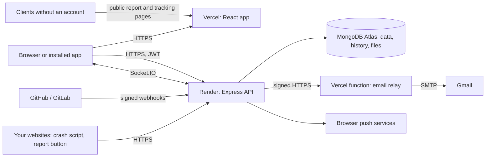

The web app is static files on Vercel and talks to the API on Render with a JWT. The API keeps everything in MongoDB
Atlas: tickets, comments, files and an append-only history of every change, which is what the analytics and time travel
are rebuilt from. Changes are pushed to everyone looking at the same project over Socket.IO. Email goes through the
relay; GitHub, GitLab and the crash-capture script reach the API through signed webhooks and keys.

### 5.1 Front page and sign-in

Visitors see what Tessera does, with a working demo of each signature feature. The demos are labelled as demos and run
on sample data in the browser, using the product's own code (the stack-trace parser and the forecast). Sign in with an
email and password, GitHub or Google; two-step login and backup codes are optional.

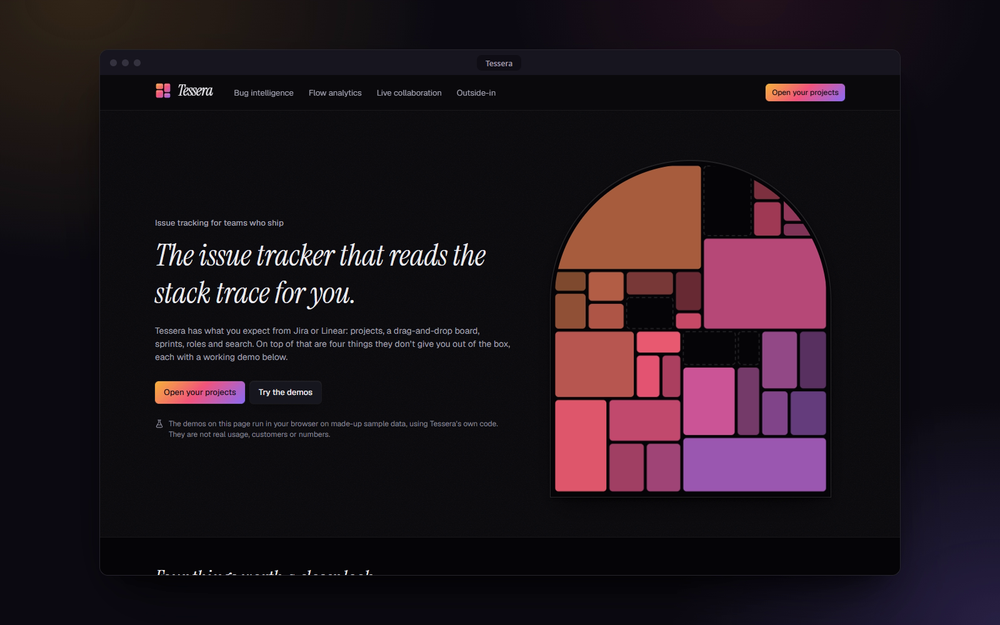

### 5.2 The board

Columns with WIP limits, swimlanes by person, priority or epic, the running sprint only, or just your cards. Cards show
type, priority, due date, service-level warnings and how long they have been in progress. Drag with the mouse, or pick a
card up with Space and move it with the arrows. Press **C** for a new ticket, **Ctrl K** to search or jump anywhere.

### 5.3 Paste a stack trace, get a bug

Choose "Paste an error" in a new ticket. The trace is read as you paste it: language, error, the frames of your own
code, what was removed (here a password, a token and an email), and whether this crash was seen before. The bug is
created with all of it, and the secrets are never stored.

### 5.4 A ticket

Everything about one piece of work in one panel: status, assignee (with how loaded each person is), priority, dates,
service levels, points and labels on the right; the description, sub-tasks, blockers, epic, sprint and milestone,
comments with mentions, files, reproduction attempts and the full history on the left. For a crash: the frames, how
often it happened and where, an impact score, past fixes, and a link to the line on GitHub.

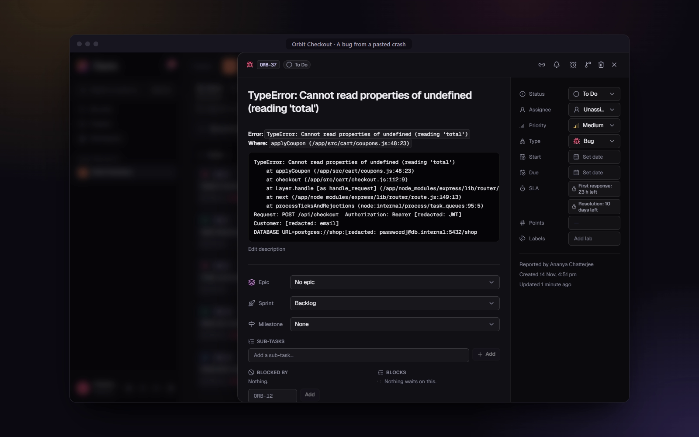

### 5.5 List, search and My work

Every ticket as a sortable list with one row of filters, saved views and a search language (`type:bug priority>=high
assignee:me due:week`). Select many to change them together; export or import CSV. My work groups your tickets by
status across all projects, with due dates and the last change.

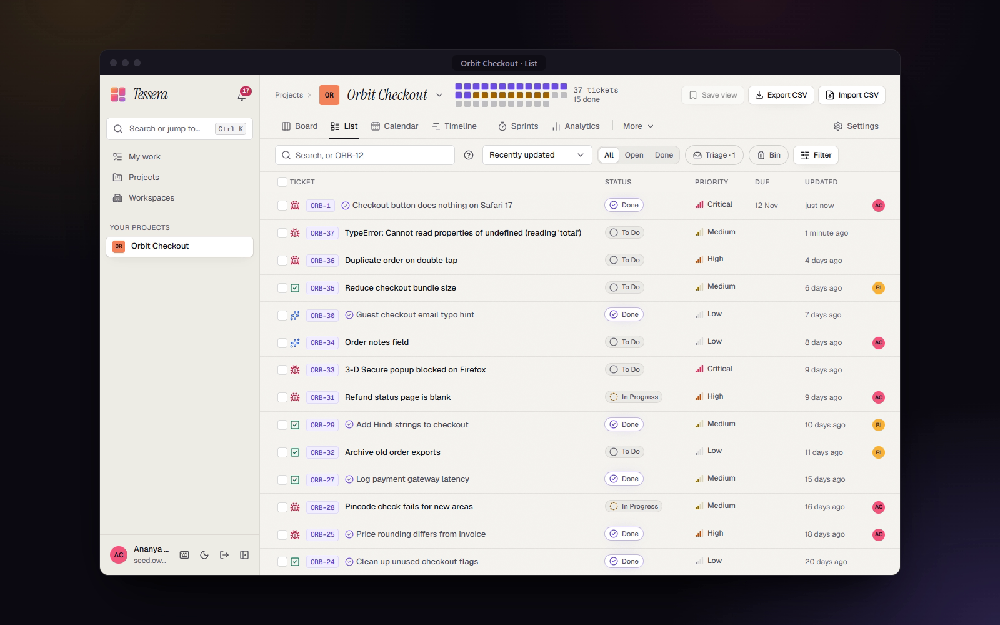

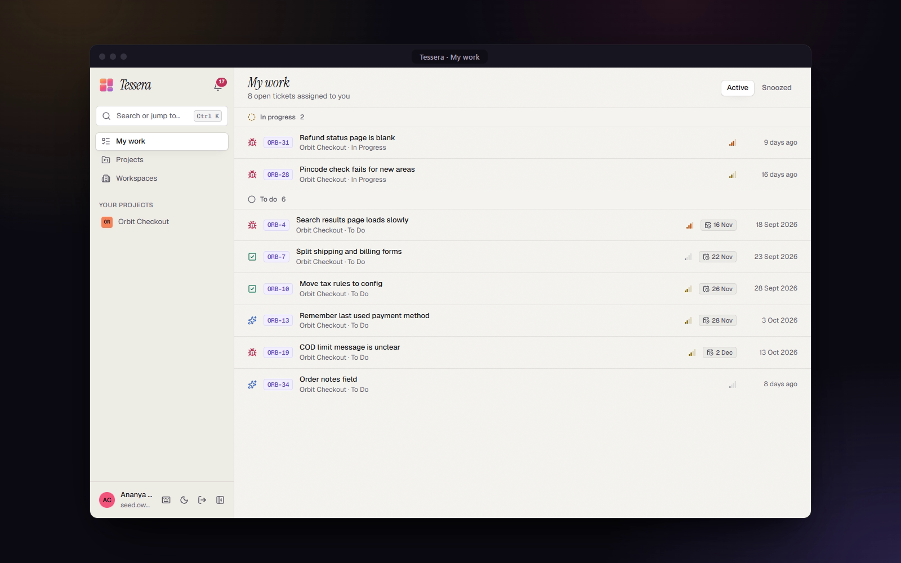

### 5.6 Planning: sprints, milestones and the timeline

Plan a sprint from the backlog, start it, and finish it with the unfinished work carried to the backlog or the next
sprint; the sprint report shows what was committed, added, finished and how long work waited. The timeline lays tickets
out from start to due date, grouped by epic, with sprints, milestones and team leave on the same axis.

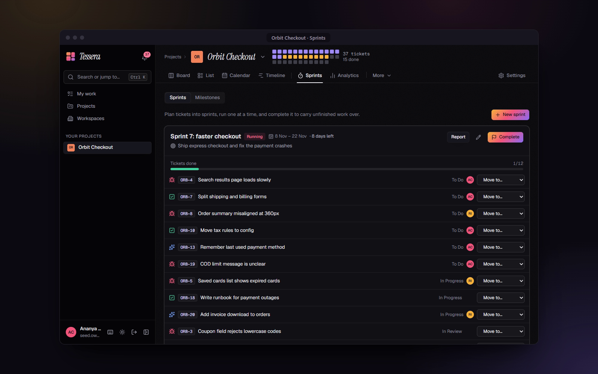

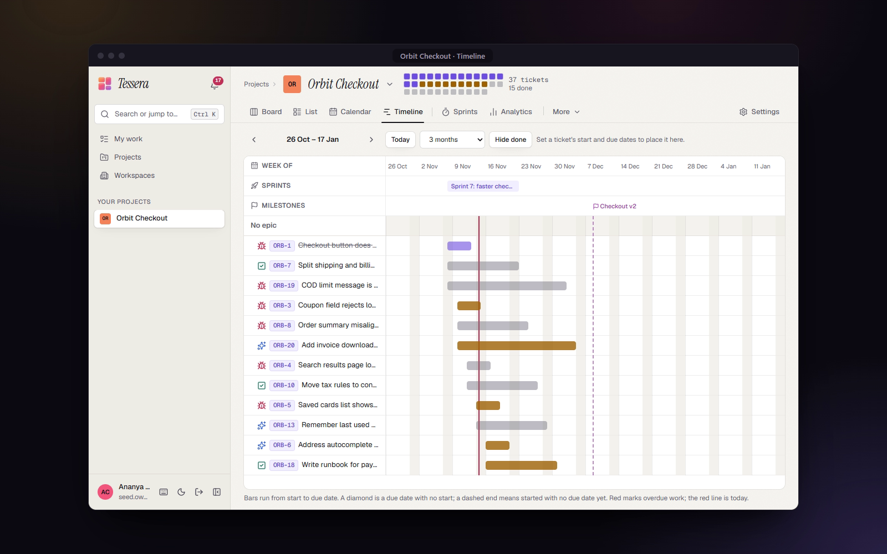

### 5.7 Analytics, forecasts and time travel

Cumulative flow, throughput, cycle time with its 85th percentile, time in each column, a workload heatmap and error
groups; every chart has a table view. The Flow tab forecasts when work will be done, ranks what to work on next and
explains in plain sentences why work is slow. Time travel rebuilds the board as it was on any past day.

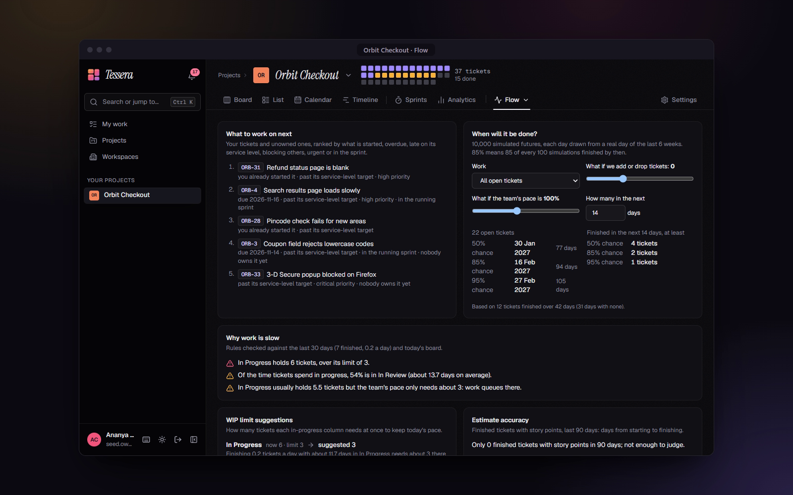

### 5.8 Live collaboration

Everyone on a board sees the same board. When Ravi picks up a card it shows "Ravi is moving this" on everyone else's
screen, then glides to where he drops it. Avatars show who is on the project and on each ticket, and who is typing a
comment. Planning poker, retro boards and incident mode run on the same connection, and edits never silently overwrite
someone else's.

### 5.9 Outside-in: public reports, triage and tracking

A public page where clients report a problem without an account, in three short steps and six languages. Reports land
in a triage inbox, where the team accepts or rejects them with single keys. Every reporter gets a private tracking link
showing where the report is, with a conversation with the team, and answers "fixed" or "still broken" at the end.

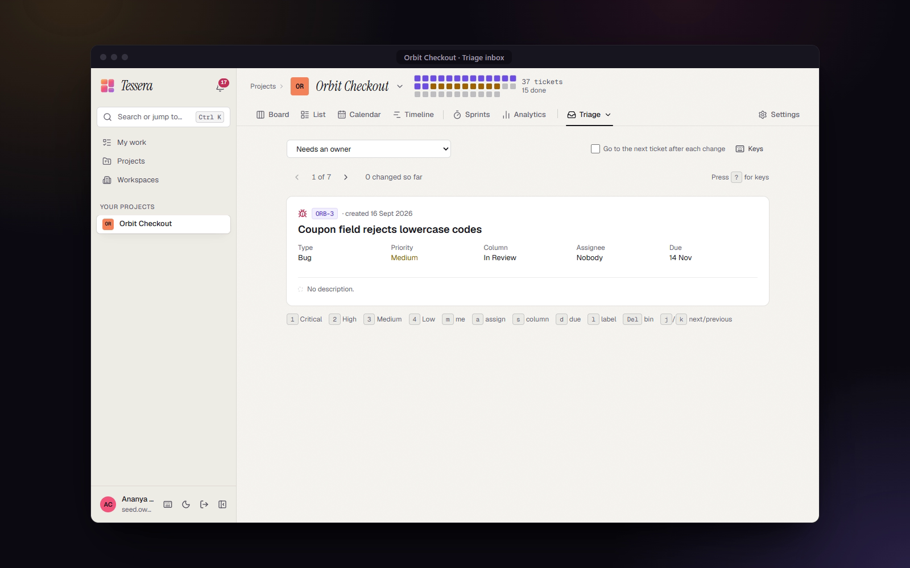

### 5.10 Settings and integrations

Project settings one group at a time: members and roles, columns and labels, custom fields, templates and recurring
tickets, automation rules and service levels, the public pages, GitHub and GitLab, Slack and Discord alerts, signed
webhooks, crash capture and source maps, backup and storage.

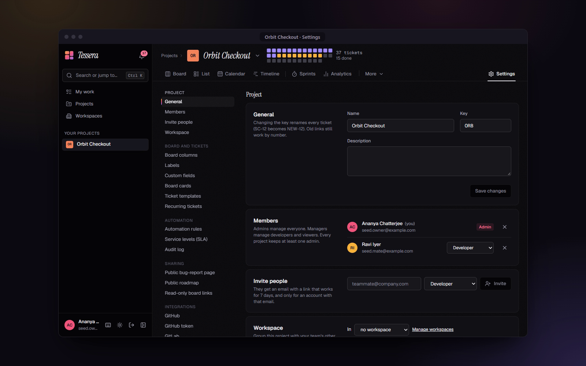

### 5.11 Phone, light and dark

The same app on a phone, and the public report page as a client sees it. Each person chooses light, dark or system,
comfortable or compact density, and an accent colour; the choice follows them to every device.

  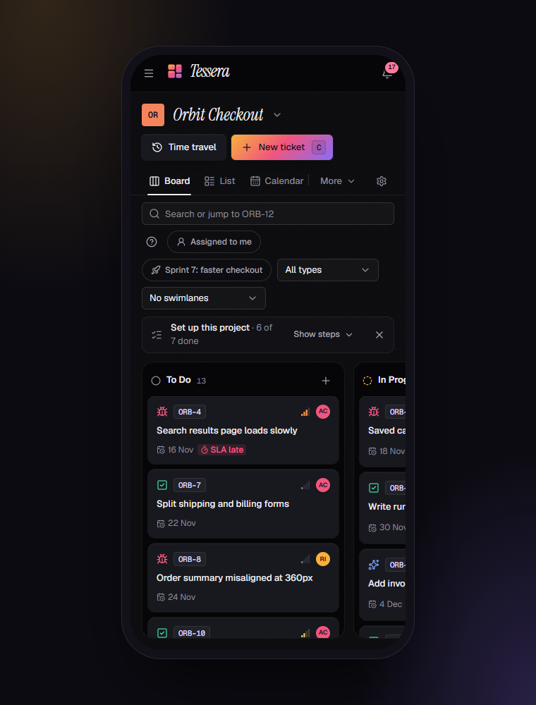
  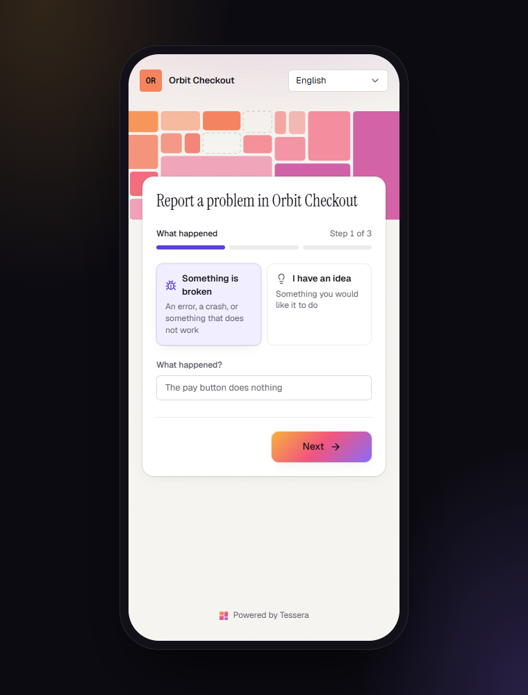

### 5.12 The design behind it

Tessera's name is the small tile a mosaic is made of: every ticket is a tile, and a board is a window of them. The mark
is four panes of glass lit by one gradient (amber, rose, violet), and the same stained glass appears in empty states,
the sign-in page and the public pages. The other directions explored on the way are in
[`design/directions/`](design/directions/).

**Principles.** Content before chrome; one primary action per view; the same control for the same job everywhere; quiet
until something needs attention. The redesign was checked against Linear and Vercel in a
[design review](docs/design-review.md): ten issues with before and after screenshots (a board header 290 px tall, a
gradient "Save" on every settings form, cards inside cards in the ticket drawer, and so on), each fixed.

**Tokens, not one-off values.** Colours, type, radii, elevation and motion live in
[`client/src/ds/tokens.css`](client/src/ds/tokens.css) and [`client/src/index.css`](client/src/index.css), and
components use only those:

- *Colour:* surfaces (canvas, sunken, surface, raised, overlay), a four-step text ramp, a key colour, status, priority
  and chart palettes. Dark mode is designed first; light mode has its own chosen values, not an inversion.
- *Type:* Geist for the interface, Instrument Serif (italic) for titles, Geist Mono for keys and code; nine sizes from
  48 px display down to 11 px micro.
- *Shape and depth:* five radii (2, 4, 6, 10, 16 px) and four elevations.
- *Motion:* a few durations and easings, used for meaning (a card landing, a change arriving from someone else), and
  still when the system asks for reduced motion.

**Personal, within limits.** Light, dark or system; comfortable or compact; and one of eight accent colours, each
checked to keep text at 4.5:1 contrast or better in both themes. The choice is saved with the account and painted
before the first frame.

**Words.** [`docs/voice.md`](docs/voice.md): clear, warm, a little witty in empty states and never cute in errors,
which always say what happened and what to do next.

**Charts.** One axis per chart, colour that follows the thing and never its rank, a texture as well as a colour for each
series, and a table view for every chart.

**Accessible and fast, and measured.** WCAG AA throughout, with a visible focus ring on every Tab stop and a board that
can be worked entirely from the keyboard. axe finds no violations on 24 states in light or dark. Lighthouse on mobile
settings (median of three cold runs, the same in both themes): the front page 97, sign-in 100, the public report page
96, the board 86 and analytics 90, with accessibility, best practices and SEO at 100 on every page and layout shift of
0.006 at most. Heavy parts (charts, the drawer, the demos) load only when needed. The audit tools are in
[`e2e/audit/`](e2e/audit/README.md).

**Screens and recordings.** Every image here comes from [`e2e/media/record.mjs`](e2e/media/record.mjs): real
interactions in the built app, in one frame (a window with a title bar and a soft shadow on the brand background, or a
phone), as PNG, MP4 and GIF.

---

## 6. Conclusion

Tessera shows that an issue tracker can do more than hold tickets: it can read the crash for you, keep secrets out of
it, tell a regression from a new bug, forecast from the team's own pace instead of guesses, keep everyone on the same
board in real time, and give the people outside the team a way in. It runs end to end on free services (Vercel, Render,
MongoDB Atlas, Gmail) and is tested at every layer.

**Known limits.** The free API server sleeps after 15 idle minutes, so the first request after that can take up to a
minute, and scheduled jobs run only while it is awake (they catch up when it wakes). Forecasts need at least five
finished tickets in the last six weeks. Source links work for GitHub repositories; other hosts get the file and line
without a link.

**What's next.** A custom domain, a keep-awake schedule on its own Render workspace, and the first real GitHub webhook
deliveries to the live API.
