# Design review: Tessera against Linear and Vercel

A design director's pass over the redesigned app (14 Nov 2026), judged against the bar Linear and
Vercel set for product UI: quiet chrome, one primary action per view, consistent property
controls, content first. Screenshots are 1280 × 800 captures from the visual tests
(`e2e/visual/screens/`). The ten issues are ranked by how often people meet them and how much they
cost. Each has a before and an after (the afters
are captured against the seeded demo project, so the data differs from the befores).

| # | Issue | Where | Fix | Status |
|---|---|---|---|---|
| 1 | The board starts 290 px down the page | Board header | One header row, slimmer filter bar | done |
| 2 | Every settings form shouts "Save" in the brand gradient, all the time | Settings | Save becomes the primary only when that form has changes | done |
| 3 | Mixed property controls: a native assignee select (name cut off) and browser date boxes showing "dd-mm-yyyy" | Ticket drawer | The design system's select and date buttons | done |
| 4 | Every label in the project is listed under the field, always | Ticket drawer | Suggestions only while adding a label | done |
| 5 | The "confirm your email" banner sits above every page and comes back every visit | Signed-in shell | A quiet notice; dismissing it is remembered | done |
| 6 | Filters take three rows before the first ticket | List | One row: a Filter menu, and the filters in use as chips | done |
| 7 | My work is a flat list with no shape: nothing about status or dates | My work | Grouped by status, with due date and last change | done |
| 8 | Project cards say "No description" and nothing about progress | Projects | Progress instead of a placeholder | done |
| 9 | Settings is one 7,300 px page | Settings | One section group at a time; the rail switches groups | done |
| 10 | Cards inside cards inside the drawer (borders on borders) | Ticket drawer | Flat sections separated by space and rules | done |

## 1. The board starts 290 px down the page

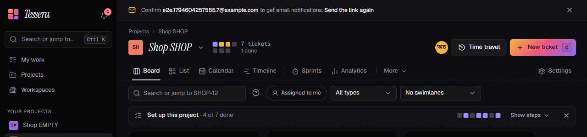

Breadcrumbs, the title row, the tabs, the filter row and the setup checklist stack up before the
first card. Linear's board header is one row (title, view tabs, filters, actions) and cards start
under 100 px from the top; Vercel's dashboards keep one header band too.

**Fix:** breadcrumbs and title share a row, the header's padding is tightened, and the filter row
loses its extra space.

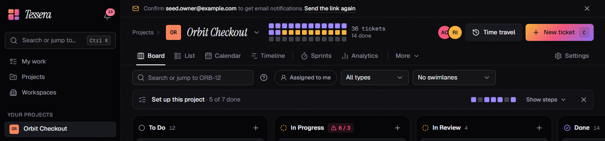

**Result:** Breadcrumb and title share one row and the header is tighter. Even with the email notice and the setup checklist showing, the board columns start at about 250 px.

## 2. "Save" in the brand gradient, everywhere, always

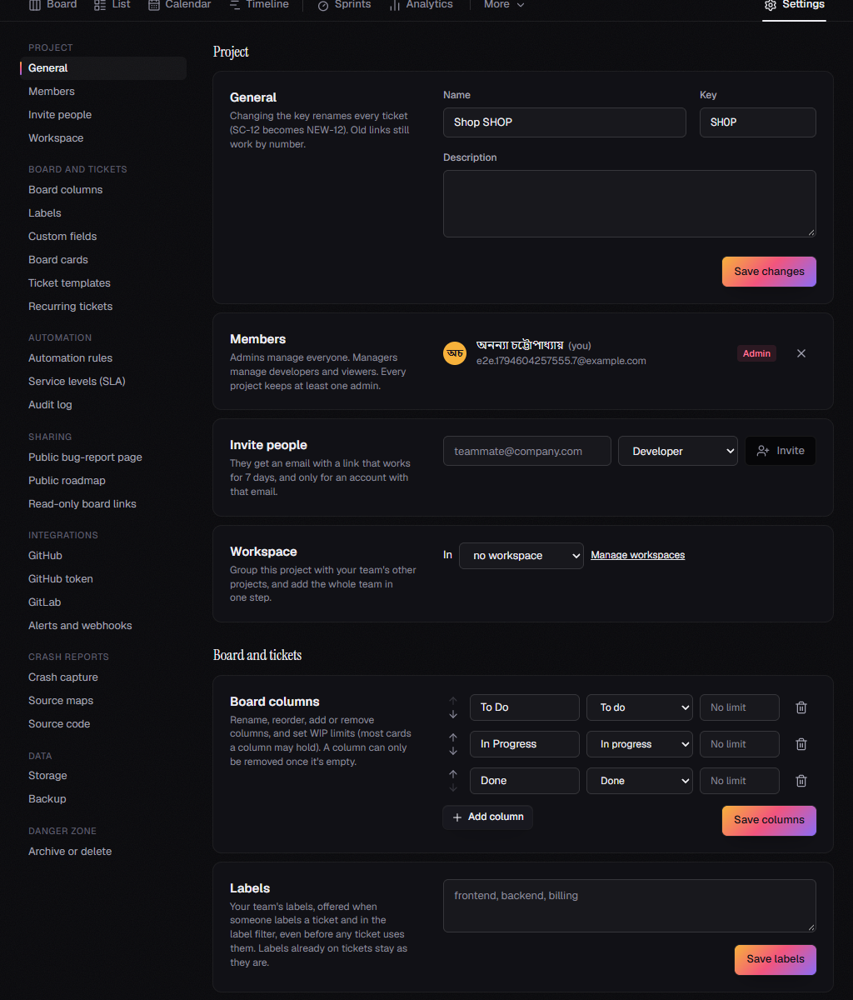

Settings shows a gradient "Save …" button in nearly every section, enabled whether or not anything
changed: a dozen primary actions on one page. Vercel's settings show one Save per form, active only
once the form has changed; Linear saves on change.

**Fix:** each settings save stays a quiet, disabled button until its form changes, then becomes the
primary.

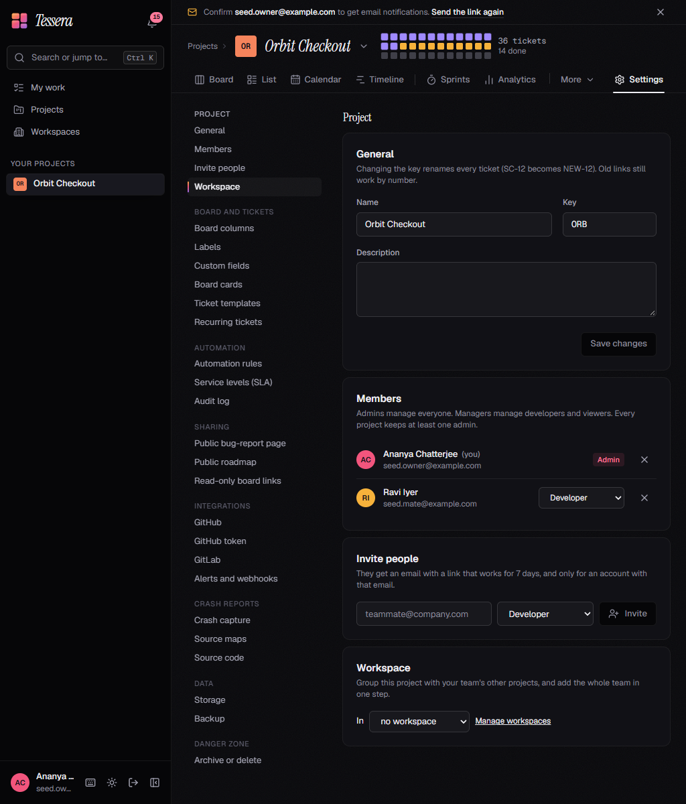

**Result:** Seven settings forms (general, columns, labels, card layout, custom fields, service levels, source code) keep Save quiet and disabled until something changes.

## 3. Mixed property controls in the drawer

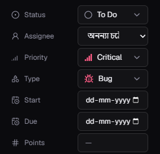

Status, priority and type use the design system's menus; the assignee is a native select whose
name is cut off by the browser's arrow, and dates are the browser's boxes showing "dd-mm-yyyy".
Linear's property panel uses one kind of control for everything.

**Fix:** the assignee becomes the design system's select (with each person's load beside them), and
dates become buttons that say "Set date" or the date, opening the date picker.

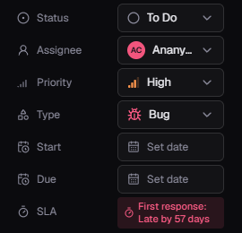

**Result:** The assignee is the design system's menu (with avatars and each person's load), and dates are "Set date" buttons over the native picker, so the keyboard and screen readers still get the real date input. Custom date fields use the same control. A long SLA chip now wraps inside the panel instead of spilling out of it.

## 4. Every label, all the time

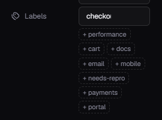

Under the labels field the drawer lists every label in the project as "+ label" chips, so the panel
grows with the project. Linear shows suggestions in the picker, when adding.

**Fix:** suggestions appear only while the labels field has focus.

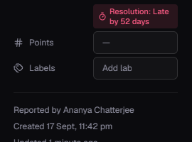

**Result:** At rest the labels field is just the field; suggestions open while it has focus.

## 5. A loud banner on every page

The email-confirmation notice spans the top of every signed-in page, above the page's own header,
and returns on the next visit after being closed. Linear and Vercel put account nudges in a quiet
corner and remember a dismissal.

**Fix:** a slim notice that, once closed, stays closed for a week.

**Result:** A slimmer, quieter line; "Hide this note for a week" is remembered per person on this device.

## 6. Three rows of filters on the list

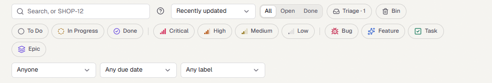

Every filter is on screen at once (status, priority, type and epic chips, three dropdowns), so the
list starts 175 px later. Linear has one "Filter" button and shows only the filters in use.

**Fix:** search, sort and the open/done switch stay; the rest moves into one Filter menu, and the
filters in use show as removable chips on the same row.

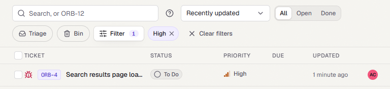

**Result:** One row: search, sort, the open/done switch, Filter (with a count) and the filters in use as removable chips. The full set opens under the bar:

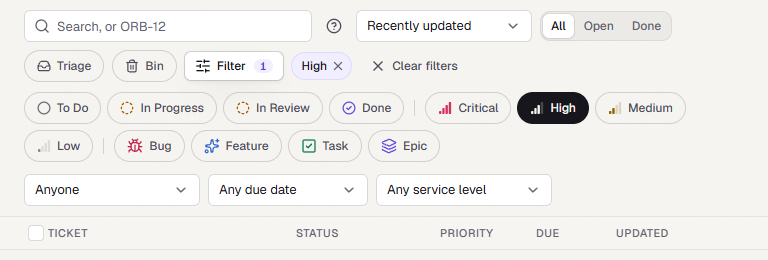

## 7. My work has no shape

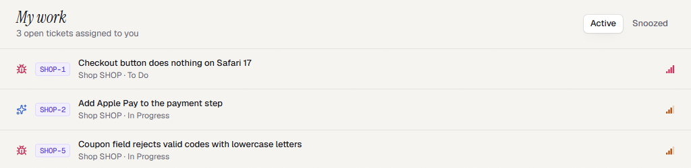

A flat list: key, title and project, nothing about what is due. Linear's "My issues" is grouped by
status with dates on the right.

**Fix:** grouped by status (in progress first), with the due date and the last change on the right.

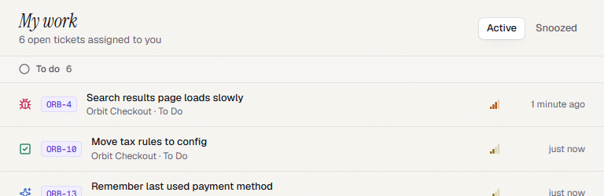

**Result:** Grouped under sticky status headers (in progress, to do, done) with a count, and the last change on the right beside the due date. The API adds each row's status category (additive).

## 8. "No description", and nothing about progress

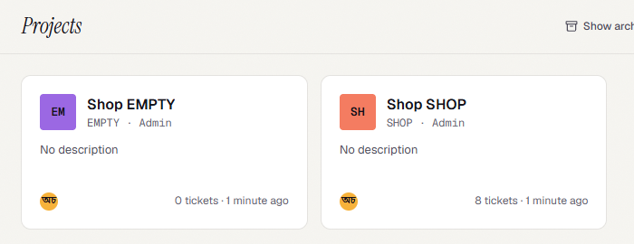

Project cards print "No description" in place of content and say nothing about how the project is
going. Vercel's project cards show the latest state; Linear's projects show progress.

**Fix:** no placeholder text; each card shows how much is done (a bar and "x of y done").

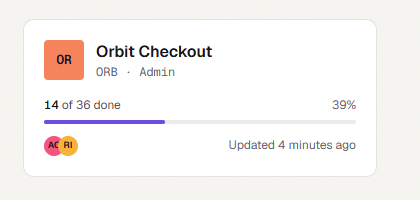

**Result:** No placeholder; a progress bar with "x of y done" and when the project last changed. The API adds `progress: {total, done}` to each project in the list (one aggregate, additive).

## 9. One 7,300 px settings page

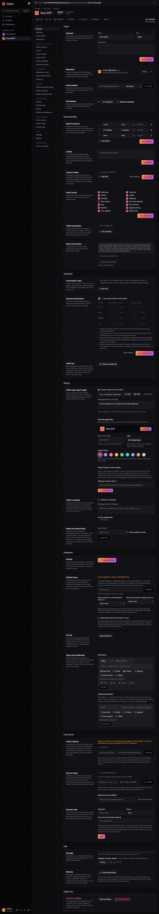

All of settings is one scroll (project, board, automation, sharing, integrations, crash reports,
data, danger zone). The rail helps, but it is still a wall. Vercel splits settings into pages;
Linear into sections.

**Fix:** the rail's groups become the pages: one group shows at a time, and the address keeps the
group so links and the back button work.

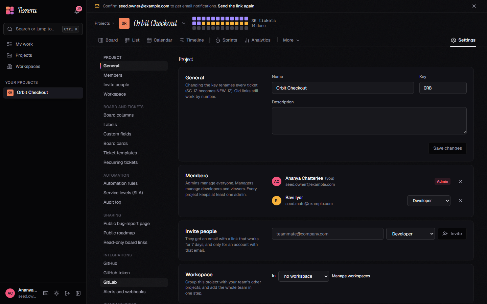

**Result:** One group at a time. The tallest group is now about 1,500 px (Integrations), against 7,300 px for the whole page before. Following a link to another group adds a step to the history, so Back returns to the previous group, and a link such as `settings#storage` opens the right group.

## 10. Cards inside cards in the drawer

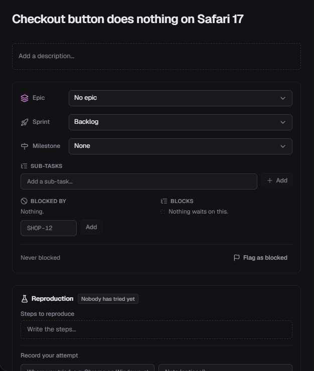

The drawer's main column puts planning, relations and reproduction each in a bordered card inside
the bordered drawer, plus a dashed box for the description. Linear's issue view is flat: a title, a
description, then sections divided by space.

**Fix:** the sections lose their boxes and are separated by space and a hairline rule; the empty
description reads as a quiet line of text.

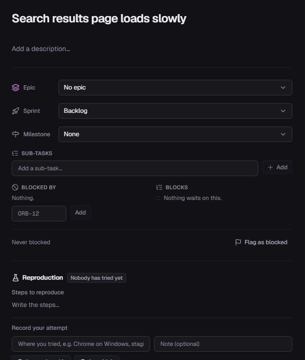

**Result:** Planning, reproduction, outside reporters and code links are sections divided by a hairline rule and space, with no boxes. "Add a description…" and "Write the steps…" are quiet lines of text that still respond on hover and keyboard focus. Callouts that carry meaning (decisions, the crash report) keep their tinted panels.
